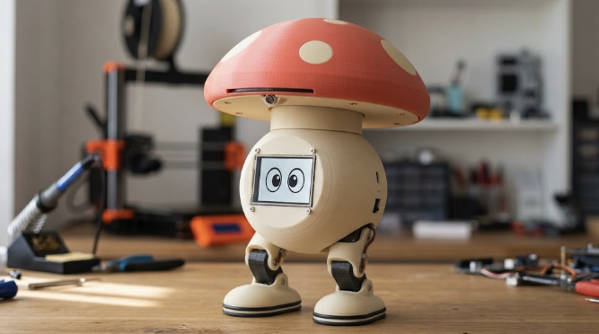
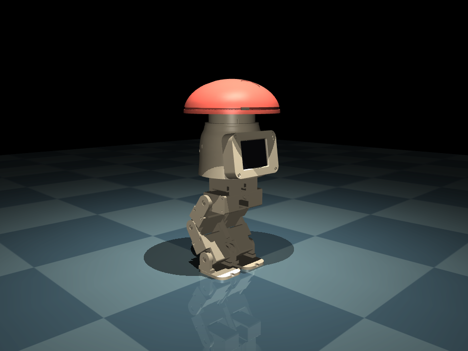
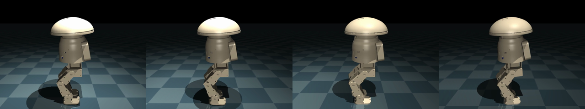

# Cogu

> 🇧🇷 Português abaixo · 🇬🇧 [English version](#english)



**Cogu** é um robô bípede de mesa (~28 cm) em forma de cogumelo, que **anda, vê e se expressa**.
É **open source e open hardware**, com design original e **100% reproduzível** por qualquer maker com uma
impressora FDM comum (referência: Bambu Lab A1 Mini).

Reprodutibilidade aqui é **requisito de engenharia**, não um detalhe: qualquer pessoa deve conseguir
imprimir, montar, modificar e redistribuir o Cogu.

- **Mudança de rumo (2026-10-30, [ADR-002](docs/decisions/ADR-002-phone-brain.md)):** o cogumelo saiu. O robô agora usa um **celular como cérebro**, em pé sobre a pelve com as câmeras traseiras para a frente, e mantém as pernas digitígradas como identidade. Fase só de simulação até ele andar bem; o texto abaixo ainda descreve o cogumelo e será reescrito. Referências de trabalho: [docs/references](docs/references/mujoco_biped_walking_refs.md).
- Status: **fase "sim primeiro"**. O robô completo — pelve, duas pernas de 5 DOF, corpo, colar e chapéu
  com 2 DOF — existe em build123d, exporta STL/STEP/MJCF e fica em pé no MuJoCo na pose de repouso
  digitígrada (joelho para trás). Altura 325 mm, massa estimada 1,32 kg
  ([ADR-001: forma do corpo](docs/decisions/ADR-001-body-shape.md)):

  
- Primeira política de caminhada do robô completo (PPO em MuJoCo Playground / MJX, 10 M passos no CPU)
  anda para frente a 0,11 m/s e sobrevive a 91 % dos episódios com empurrões —
  [vídeo](docs/renders/sim_walk_v1.mp4), detalhes em [sim/playground](sim/playground/README.md):

  
- Documento de decisões completo: [docs/decisions/ADR-000-project-brief.md](docs/decisions/ADR-000-project-brief.md)
- Inspiração de stack: Open Duck Mini v2 / Microduck (Pollen Robotics).

## Visão rápida

| | |
|---|---|
| Altura / massa | 325 mm (alvo do brief: ~280) · ≈ 1,32 kg (alvo: < 1,2 kg) — ver ADR-001 |
| Chapéu | Ø 160 mm, domo baixo (55 mm), coral com 3 manchas creme; abriga câmera, ToF multizona e anel de LEDs; 2 DOF de tilt (pitch ±15°, roll ±12°) escondidos no colar |
| Corpo | Ovo creme Ø 110 mm, Ø 115 na saia (o brief dizia ~95: a pilha do quadril e a tela não cabem em menos) que esconde a pelve e os servos de yaw: Pi Zero 2W, IMU BNO055, bateria 2S, placa de servos. Tela CYD 2,8" na frente, inclinada 12° para cima, moldura com 4 parafusos |
| Pernas | 5 DOF cada (hip yaw / roll / pitch, joelho, tornozelo). Coxa 60 mm, canela 60 mm, pé 15 mm. **Digitígradas** (joelho para trás, como uma ave) e curtas de propósito: CoM baixo, passada curta |
| Atuadores | 12 × Feetech STS3215 (serial bus, 7,4 V) |
| Software | MuJoCo Playground (RL + domain randomization), identificação de atuador com BAM, política ONNX a 50 Hz no Pi |

## Constituição do hardware (regras invioláveis)

Qualquer PR que viole estas regras deve ser recusado.

1. **100% impresso em 3D** (FDM). Zero usinagem, laser, chapa, carbono ou peça sob encomenda.
2. **Cabe na A1 Mini**: nenhuma peça com mais de **160 mm** na maior dimensão. Suportes mínimos, orientação de impressão documentada por peça.
3. **Só PLA e PETG.** Sem TPU, resina, nylon ou CF. Flexibilidade e grip vêm de O-rings ou de geometria flexível em PETG.
4. **Fixação padronizada**: insertos roscados a quente **M3 × 5,7 mm** (furo Ø4,0 × 6,5 mm, parede ≥ 2 mm); parafusos **M3 × 8 / 12 / 16** allen cilíndrico, e só esses três; servos fixados com o horn metálico e os parafusos M2 originais.
5. **Rolamentos 688ZZ** (8 × 16 × 5 mm) em toda articulação, no lado oposto ao horn.
6. **Grip dos pés com O-rings de nitrilo** em canais impressos, sem cola, trocáveis.
7. **Folgas de 0,2–0,3 mm** em todo encaixe; arquivo de calibração no repositório.
8. **Nenhum cabo externo**: canais de cabo dentro da coxa e da canela.
9. **Só componentes de prateleira**, com alternativas por região no BOM.

Essas regras são verificadas em código em `cad/design_rules.py` e rodam no CI, junto com
`cad/check_envelopes.py` (varre cada junta do quadril e mede colisões exatas entre as peças impressas) e
`cad/check_body.py` (corpo contra a perna em todo o range do quadril, chapéu contra os joelhos ao agachar,
ranges do pescoço).

## Primeiros 60 minutos

```bash
# 1. Clonar e instalar (precisa de uv: https://docs.astral.sh/uv/)
git clone https://github.com/laroccathebrux/cogu.git && cd cogu
uv sync

# 2. Gerar STL / STEP / MJCF do robô
uv run python -m cad.export

# 3. Abrir o robô no MuJoCo
uv run python sim/check_mjcf.py              # carrega, confere massas e simula 3 s em pé
uv run python -m mujoco.viewer --mjcf build/mjcf/cogu_lower_body.xml   # visualizador interativo

# 4. Treinar a primeira política de caminhada (PPO em MJX; ~4 min de smoke test no CPU)
uv run python sim/playground/train.py --steps 200000 --num-evals 2
uv run python sim/playground/rollout.py      # grava build/videos/walk.mp4

# 5. Antes de imprimir as peças reais: imprimir os testes de calibração
ls build/stl/test_prints/                    # insert_test, fit_test, bearing_test
```

O treino de verdade (10–100 M passos) e como rodá-lo em GPU / Hugging Face Jobs estão em
[sim/playground/README.md](sim/playground/README.md).

As peças ficam em `build/stl/<peça>.stl`, já na orientação de impressão.

## Estrutura do repositório

```
cad/            CAD paramétrico em build123d (fonte única de verdade)
  parameters.py   todas as dimensões do robô
  design_rules.py checagens das regras de hardware
  parts/          uma peça por arquivo
  export.py       gera STL / STEP / MJCF
  test_prints/    calibração de insertos e pino/furo
sim/            MuJoCo Playground (sim/playground: env, treino PPO, rollout), identificação de atuador (BAM)
firmware/       face-esp32 (CYD, olhos) · runtime-pi (loop 50 Hz, política ONNX)
hardware/       esquemas de fiação
docs/           decisões (ADRs), guia de montagem, BOM, protocolo de expressão
```

O MJCF é **gerado** a partir do CAD, nunca editado à mão.

## Roteiro

1. **Sim primeiro**: robô em build123d → MJCF → política de caminhada no MuJoCo Playground. *(fase atual; corpo, colar e chapéu modelados, política ainda só com as pernas)*
2. **Uma perna real**: imprimir, montar, rodar BAM no STS3215, comparar com a sim.
3. **Robô completo**: corpo, chapéu, CYD, política treinada, primeiro vídeo, release v0.1.
4. Depois: documentação de ensino, variantes de perna, v2 (dinossauro sobre as mesmas pernas).

## Decisões em aberto

- Nome final (Cogu?) e checagem de marca/domínio.
- Confirmar CERN-OHL-S (adotada provisoriamente) vs CERN-OHL-P.
- Bateria exata após fechar o volume interno do corpo.
- Manchas do chapéu: troca de cor vs peças encaixadas.

## Licenças

- Hardware (CAD, STL, esquemas): [CERN-OHL-S v2](LICENSE-HARDWARE)
- Software (cad/, sim/, firmware/): [Apache-2.0](LICENSE)
- Documentação: [CC-BY 4.0](LICENSE-DOCS)

---

<a name="english"></a>
# English

**Cogu** is a ~28 cm desktop bipedal robot shaped like a mushroom that **walks, sees and expresses itself**.
It is **open source and open hardware**, with an original design that is **100% reproducible** by any maker
with a common FDM printer (reference: Bambu Lab A1 Mini). Reproducibility is an engineering requirement,
not a nice-to-have.

- **Change of direction (2026-10-30, [ADR-002](docs/decisions/ADR-002-phone-brain.md), Portuguese):** the mushroom is gone. The robot now uses a **phone as its brain**, standing on the pelvis with the rear cameras facing forward, and keeps the digitigrade legs as its identity. Simulation-only until it walks well; the text below still describes the mushroom and will be rewritten.
- Status: **"sim first" phase**. The complete robot — pelvis, two 5-DOF legs, body, collar and a 2-DOF
  cap — exists in build123d, exports to STL/STEP/MJCF and stands in MuJoCo at the digitigrade rest pose
  (see the render above; 325 mm tall, ≈ 1.32 kg; body-shape decision in
  [docs/decisions/ADR-001-body-shape.md](docs/decisions/ADR-001-body-shape.md), Portuguese). A first walking policy for
  the complete robot (PPO on MuJoCo Playground / MJX, 10 M steps on a laptop CPU) walks forward at 0.11 m/s
  and survives 91 % of pushed episodes ([video](docs/renders/sim_walk_v1.mp4), details in
  [sim/playground](sim/playground/README.md)).
- Full decision record (Portuguese): [docs/decisions/ADR-000-project-brief.md](docs/decisions/ADR-000-project-brief.md)
- Stack inspiration: Open Duck Mini v2 / Microduck (Pollen Robotics).

## At a glance

| | |
|---|---|
| Height / mass | 325 mm (brief target ~280) · ≈ 1.32 kg (target < 1.2 kg) — see ADR-001 |
| Cap | Ø 160 mm low dome (55 mm), coral with 3 cream spots; houses camera, multizone ToF and LED ring; 2-DOF tilt (pitch ±15°, roll ±12°) hidden in the collar |
| Body | Cream egg Ø 110 mm, Ø 115 at the skirt (the brief said ~95: the hip stack and the display need more) hiding the pelvis and yaw servos: Pi Zero 2W, BNO055 IMU, 2S LiPo, servo board. 2.8" CYD display on the front, tilted 12° up, 4-screw bezel |
| Legs | 5 DOF each (hip yaw / roll / pitch, knee, ankle). Thigh 60 mm, shin 60 mm, foot 15 mm. **Digitigrade** (backwards knee, bird-like) and deliberately short: low CoM, short stride |
| Actuators | 12 × Feetech STS3215 (serial bus, 7.4 V) |
| Software | MuJoCo Playground (RL + domain randomization), actuator identification with BAM, ONNX policy at 50 Hz on the Pi |

## Hardware constitution (non-negotiable rules)

Any PR that breaks these rules must be rejected.

1. **100% 3D printed** (FDM). No machining, laser cutting, sheet metal, carbon tube or custom-made parts.
2. **Fits the A1 Mini**: no part larger than **160 mm** in its longest dimension. Minimal supports, documented print orientation per part.
3. **PLA and PETG only.** No TPU, resin, nylon or CF. Flexibility and grip come from O-rings or compliant PETG geometry.
4. **Standardized fasteners**: **M3 × 5.7 mm** heat-set inserts (Ø4.0 × 6.5 mm hole, ≥ 2 mm wall); **M3 × 8 / 12 / 16** socket-head screws and only those three; servos mounted with the metal horn and the original M2 screws.
5. **688ZZ bearings** (8 × 16 × 5 mm) on every joint, opposite the servo horn.
6. **Nitrile O-rings for foot grip**, in printed channels, no glue, replaceable.
7. **0.2–0.3 mm clearance** on every fit; calibration print in the repo.
8. **No external cables**: cable channels inside thigh and shin.
9. **Off-the-shelf components only**, with regional alternatives in the BOM.

These rules are checked in code in `cad/design_rules.py` and run in CI, together with
`cad/check_envelopes.py`, which sweeps every joint and measures exact overlaps between printed parts.

## First 60 minutes

```bash
git clone https://github.com/laroccathebrux/cogu.git && cd cogu
uv sync                                    # needs uv: https://docs.astral.sh/uv/
uv run python -m cad.export                # STL / STEP / MJCF of the leg
uv run python sim/check_mjcf.py            # loads the MJCF, checks masses, stands for 3 s
uv run python -m mujoco.viewer --mjcf build/mjcf/cogu_lower_body.xml
uv run python sim/playground/train.py --steps 200000 --num-evals 2   # PPO smoke test on MJX (~4 min, CPU)
uv run python sim/playground/rollout.py    # writes build/videos/walk.mp4
ls build/stl/test_prints/                  # print these calibration parts first
```

The real training run (10–100 M steps) and how to scale it on a GPU / Hugging Face Jobs are described in
[sim/playground/README.md](sim/playground/README.md) (Portuguese).

## Licenses

- Hardware (CAD, STL, schematics): [CERN-OHL-S v2](LICENSE-HARDWARE)
- Software (cad/, sim/, firmware/): [Apache-2.0](LICENSE)
- Documentation: [CC-BY 4.0](LICENSE-DOCS)
