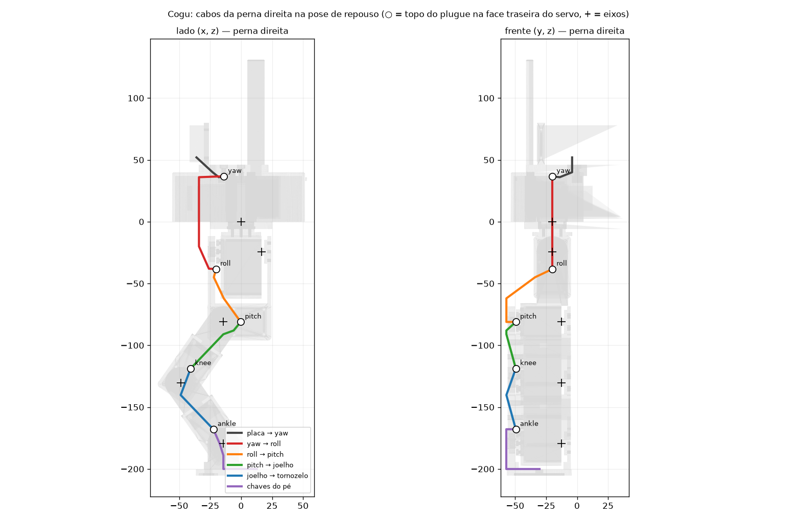
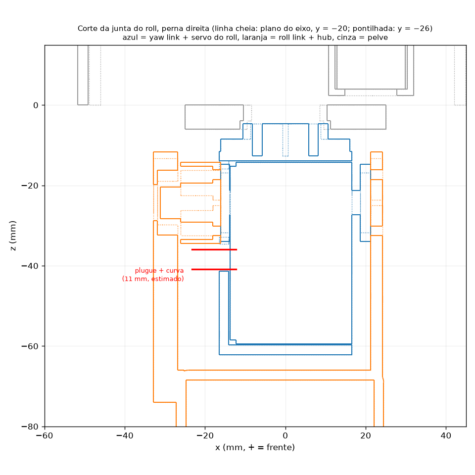

# Cabos do Cogu: análise de passagem (2026-10-30)

Estado: **análise; no CAD, só o roll foi resolvido (A1, 2026-10-30).** As decisões em aberto estão no fim.

## O que precisa de fio

| Ligação | Fios | Atravessa juntas? |
|---|---|---|
| Barramento dos servos, 1 cadeia por perna: placa → yaw → roll → pitch → joelho → tornozelo | 3 (sinal, V+, GND), cabo 5264 de 3 vias | sim, uma junta por trecho |
| Chaves dos pés, as 2 em paralelo dentro do pé → GPIO da placa | 2 por pé | as 5 juntas da perna |
| IMU (I²C) → placa | 4 | não (tambor → berço) |
| Bateria → fusível → chave → XT30 → plugue DC da placa | 2 × 22 AWG | não |
| Celular ↔ placa | sem fio (Bluetooth) | — |

Os servos são de barramento: cada perna é **uma cadeia só**. Cada STS3215 tem 2 conectores 5264 ligados em
paralelo (entra por um, sai pelo outro). São 10 trechos de cabo, cada um atravessando **uma** junta, mais o par
do pé, que percorre a perna inteira junto com eles.

## Onde ficam os conectores (corrigido)

Pela foto do anúncio (2026-10-30), os dois conectores ficam **na face traseira** do servo, a tampa do lado oposto
ao horn. Ficam lado a lado na largura, a **~11,6–16,5 mm do eixo** (centro a ~14 mm), e o plugue entra
perpendicular à face. O `link.py` supunha os conectores na ponta do corpo e abriu um canal no topo da peça,
`CABLE_CHANNEL_*`. Esse canal não serve para nada e sai na revisão.

Consequência boa: nas coxas, canelas e no pitch, a face traseira do servo é a face **de fora** da perna (lado do
rolamento). Os conectores já nascem do lado onde há espaço livre.

Consequência ruim: entre a face traseira e a próxima peça há pouco espaço. A placa do rolamento do garfo seguinte
fica a **8,6 mm** da face (−28,75 → −37,35 no referencial da junta). O plugue montado mais a curva do fio devem
pedir uns 11 mm. **A medir:** altura do plugue encaixado acima da face e o raio mínimo da curva do cabo.

## Espaço na frente dos conectores, em todo o curso das juntas

Medido com as malhas reais das peças (`analise/headroom2.py`). Vale para a área dos dois soquetes, perna direita:

| Servo | Para onde a face traseira olha | O que fica na frente | Situação |
|---|---|---|---|
| yaw (pelve) | para cima, dentro do tambor | tampo do tambor a 8,2 mm, depois a base do berço (6 mm), depois o celular | **não cabe** sem janela no tampo |
| roll (yaw link) | para trás | paddle traseiro do U do roll, o tempo todo: era a 8,6 mm, agora a **14,6 mm** | **resolvido (A1)** |
| pitch (viga do roll link) | para fora | paddle do rolamento da coxa cobre o soquete de baixo e metade do de cima com a perna toda à frente (−5…+15°) | **parcial**: um soquete fica livre |
| joelho (coxa) | para fora | só a borda do disco do paddle da canela (1 mm do lado do eixo) | **ok** com janela na própria coxa |
| tornozelo (canela) | para fora | só a borda do disco do paddle do pé | **ok** com janela na própria canela |

Nos links (joelho e tornozelo), o braço do paddle da peça de baixo aponta para longe dos conectores. Por isso
sobra espaço: o problema é só a parede traseira e a bochecha traseira da própria peça, que podem ganhar janela e
canal.

## Proposta: "espinha de fora"



1. **Tudo pelo lado de fora de cada perna.** Os cabos correm em canaletas rebaixadas nas faces externas
   (plano das placas de rolamento, y = ±56 no mundo). Os dois pés ficam a 10 mm um do outro, então o lado de
   dentro não tem espaço.
2. **Cada trecho atravessa a junta perto do eixo**, num laço curto por fora das faces planas: nada fica entre
   peças que se cruzam. A distância em linha reta entre os conectores muda pouco ao longo do curso:

   | Trecho | Junta | Distância (mín … máx) | Rota esquemática |
   |---|---|---|---|
   | placa → yaw | — | 33 mm | ~40 mm |
   | yaw → roll | yaw | 75 … 76 mm | ~100 mm |
   | roll → pitch | roll | 54 … 62 mm | ~75 mm |
   | pitch → joelho | pitch | 45 … 60 mm | ~60 mm |
   | joelho → tornozelo | joelho | 48 … 60 mm | ~65 mm |
   | chaves do pé → tornozelo | tornozelo | — | ~95 mm, depois ~340 mm junto com o feixe até a placa (~430 mm) |

   A rota esquemática é uma estimativa. O comprimento de verdade sai com barbante no protótipo em PLA laranja.
3. **Coxa e canela:** uma janela na parede traseira, sobre os soquetes, e um canal na bochecha traseira que sobe
   até a junta de cima e sai pela face externa. Carrega 1 cabo de servo e o par do pé (5 fios).
4. **Pé:** o que já foi proposto ([folga_pe_tornozelo.png](folga_pe_tornozelo.png)). As chaves ficam em paralelo,
   ligadas por uma canaleta de 2,5 × 1,5 mm no topo da sola (sob o eixo sobram só 2,5 mm até a canela). Em
   x = 0, uma canaleta e um túnel levam os fios à face externa do paddle do rolamento, e eles sobem até r ≈ 9 mm
   do eixo. Os terminais da chave de trás são cortados para ~2 mm: sobram 4,8 mm ali.
5. **Pelve e tambor:** os cabos da placa descem pelo furo do berço/tampo (x = −23), ao lado dos conectores do
   yaw (x ≈ −12…−17, y ≈ ±10…30). O cabo yaw → roll desce por trás da pelve, por dentro da parede do tambor,
   e chega por trás ao roll. A distância quase não muda no curso do yaw (0,4 mm): os dois servos ficam perto
   do eixo.

## Problemas que pedem decisão

**A. Roll: conectores tampados pelo paddle traseiro do U. Decidido: A1 (afastar o paddle), feito no CAD.**



- O paddle traseiro do U recuou `ROLL_REAR_PADDLE_SHIFT` = 6 mm. Ele roda num hub traseiro próprio,
  `back_hub_roll`: placa de 10 mm em vez de 4, com escareados 6 mm mais fundos, para usar os mesmos parafusos M2.
- A viga do pitch **não** se moveu: recuá-la deixaria o paddle da frente solto na boca aberta da viga, por onde o
  servo entra. Um bloco de raiz atrás da viga segura o paddle. O bloco para 1 mm antes da placa do horn da coxa,
  que passa ali com o pitch abaixo de −60°. A perna fica no mesmo lugar: o centro de massa não muda.
- A parede traseira do yaw link ganhou uma janela sobre os soquetes (`servo_housing(bus_window=True)`). Entre a
  parede e o paddle sobram 10,4 mm livres, ou 14,6 mm contados da face do servo, em todo o curso do roll. O plugue
  com a curva (~11 mm, estimado) cabe com ~3,6 mm de folga.
- Conferido: `check_envelopes` com os mesmos intervalos livres de antes; o roll link pesa +1,8 g. A política v5
  anda igual no modelo novo (`gait_metrics`: 23 passos, 46/49 % no ar, pé a 26,3/24,2 mm contra 26,3/24,3).
- 6 mm é estimativa: revisar quando o plugue for medido.

**B. Pitch: um dos soquetes fica coberto com a coxa toda à frente.**
- B1: usar só o soquete livre, com um cabo em Y (os dois soquetes são o mesmo barramento, então um plugue com
  dois cabos emendados serve de entrada e saída).
- B2: limitar o pitch a ≤ −5° à frente. Antes, ver no log da política quanto ela usa de fato.

**C. Yaw: 8,2 mm até o tampo do tambor.** Abrir uma janela no tampo e na base do berço sobre os conectores de
cada yaw, juntando-a ao furo dos cabos da placa. Os insertos do berço (x = −14 e 0, y = 0) ficam entre as duas
janelas. Embaixo do celular sobram ~17 mm.

**D. Corrente no começo da cadeia.** O trecho placa → yaw e o yaw → roll levam a corrente dos 5 servos da perna.
Os terminais 5264 aguentam ~3 A. Andando deve ficar abaixo disso, mas um travamento de vários servos passa.
Usar o fio mais grosso (22 AWG) nesses dois trechos e conferir a corrente no hardware.

**E. Fio do pé:** 28–30 AWG de silicone. O 22 AWG comprado é grosso para as canaletas.

## A conferir no hardware

- Altura do plugue 5264 encaixado acima da face traseira, e curva mínima do cabo (define A, B e C).
- Posição exata dos soquetes na face traseira (a foto dá ±1–2 mm).
- Comprimento dos cabos que vieram com os servos.
- Pinos livres na placa Waveshare para os 2 GPIOs dos pés e o I²C da IMU.

## Como refazer as medições

Scripts descartáveis em `analise/`. Rodar da raiz do repositório; o argumento é a pasta das saídas (fica fora do git, em `build/`):

```bash
PYTHONPATH=. uv run python hardware/wiring/analise/headroom2.py build/wiring
```

```bash
PYTHONPATH=. uv run python hardware/wiring/analise/route_fig.py build/wiring
```

```bash
PYTHONPATH=. uv run python hardware/wiring/analise/ankle_clear.py build/wiring
```

```bash
PYTHONPATH=. uv run python hardware/wiring/analise/roll_section.py build/wiring
```

O conector entra nos scripts como suposição: centro a 14 mm do eixo na face traseira e plugue de 8 mm. A posição dos
soquetes está em `ServoSTS3215.bus_socket_*` (`cad/parameters.py`), mas a geometria ainda
não existe no modelo do servo (`cad/parts/sts3215.py`).
