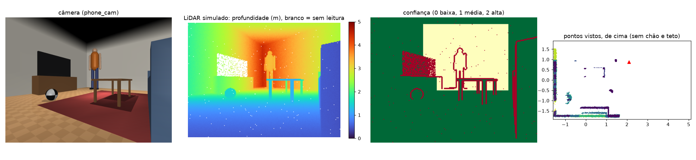
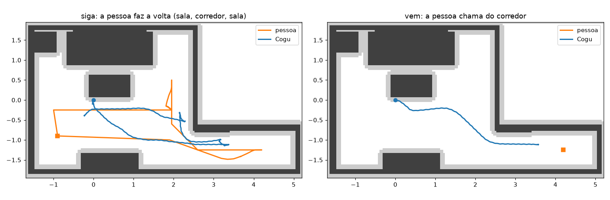
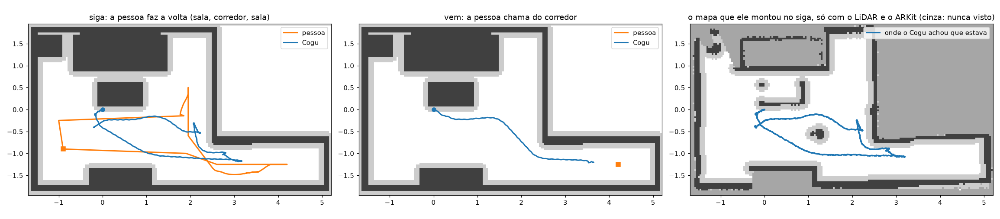

# sim/brain — o cérebro do Cogu no simulador (ADR-004)

O cérebro do bichinho (percepção, memória do mundo, navegação, comportamento, conversa) é prototipado aqui, contra o
MuJoCo, antes do app em Swift. Tudo que o celular vai ver sai da câmera `phone_cam` do modelo.

| Arquivo | O que faz |
|---|---|
| `apartment.py` | Monta um apartamento em volta do robô com MjSpec (o MJCF do robô não é tocado) → `build/mjcf/apartment.xml` |
| `phone_sensors.py` | O LiDAR do iPhone (`Lidar`) e a posição do ARKit (`ArkitPose`), simulados a partir da `phone_cam` |
| `navigation.py` | Mapa do chão, planejador e seguidor de caminho que viram o comando da marcha (vx, vy, wz) |
| `perception.py` | O que o cérebro sabe: o estado verdadeiro, ou só o celular (mapa do LiDAR, pose do ARKit, pessoa e bola pela câmera) |
| `pet.py` | Os comandos simples (pare, fica, vem, siga) no apartamento, a pessoa que anda, os cenários de teste e o viewer |
| `memory.py` | A memória do mundo: o que está onde, quando foi visto, para que serve; lugares com nome; o resumo em texto |
| `behavior.py` | O motor de comportamento: as ferramentas que a conversa vai chamar, os comandos falados e o que ele faz sozinho |
| `conversation.py` | A conversa: frases fixas sem LLM; o resto vai a um modelo de linguagem com as ferramentas e o resumo da memória |
| `eleven.py` | A ElevenLabs: o agente (modelo na nuvem), o ouvido (Scribe) e a voz, com as frases fixas gravadas |
| `protocol.py` | Os pacotes entre o celular e a medula (ADR-005): COMANDO e TELEMETRIA, binários, ≤ 20 bytes, com CRC |
| `medula.py` | A medula (o que o firmware do ESP32 vai fazer: marcha, posturas, quedas, watchdog, bateria) e um rádio falso |
| `medula_c.py` | O firmware da medula (C++, `firmware/medula`) no lugar do `medula.py`, e a conferência entre os dois |

## Apartamento

Sala de 4 × 3,5 m com sofá, mesa de centro (40 cm: ele vê por baixo, mas não passa), rack com TV preta (o LiDAR a
perde), planta e tapete; uma porta para um corredor de 2,5 m; uma **bola de futebol** tamanho 5 (22 cm, 430 g, casca
oca que rola, `--ball` para os tamanhos 3 e 4) que o robô pode empurrar; uma **pessoa** de 1,7 m (corpo mocap: o
cérebro a move; ela empurra o robô se andar contra ele). O teto existe só para a câmera e o LiDAR (grupo 5), não
para o viewer. O robô continua primeiro no `qpos`, então as políticas leem como antes.

```bash
uv run python sim/brain/apartment.py
uv run mjpython sim/playground/play.py --checkpoint sim/playground/checkpoints/cogu_walk_v10 \
    --getup sim/playground/checkpoints/cogu_getup_v8 --pose script --xml build/mjcf/apartment.xml
```

A marcha v10 anda igual dentro dele (8 s a 0,15 m/s: 1,30 m, como no modelo de treino); sentar, levantar e deitar
também.

## LiDAR e ARKit simulados

O robô usa o LiDAR do iPhone. O simulador não tem LiDAR, então `Lidar` renderiza a profundidade da `phone_cam` e a
estraga como o sensor real:

- mapa de 256 × 192, profundidade em metros, 0 = sem leitura;
- alcance ~5 m; ruído crescendo com a distância (~1 cm a 1 m);
- superfícies escuras (e o que se chamar glass / mirror) quase não voltam;
- bordas com salto de profundidade ("flying pixels") com confiança baixa, como o mapa de confiança do ARKit (0, 1, 2);
- ARKit: a pose da câmera chega 50 ms atrasada, com deriva lenta (posição e rumo) e ruído.

```bash
uv run python sim/brain/phone_sensors.py --at 2.1 0.9 -145    # -> docs/renders/sim_lidar.png
```



## Comandos com percepção perfeita: pare, fica, vem, siga

O primeiro passo do cérebro usa as posições verdadeiras (robô, pessoa, bola) em vez da câmera; a navegação e os
comandos são os mesmos que o app vai usar quando a percepção vier do LiDAR e da câmera.

- **pare**: zera o comando na hora (sem rampa) e fica parado até o próximo comando. Para em ~0,4 s, andando a
  0,25 m/s, e não sai do lugar (2 cm).
- **fica**: fica onde está e vira para a pessoa quando ela sai de ±25° da frente.
- **vem**: vai até 0,5–0,6 m da pessoa, por onde for mais curto e longe dos móveis, para de frente para ela e passa
  para "fica".
- **siga**: anda atrás da pessoa a ~0,75 m, inclusive pela porta e pelo corredor; espera virado para ela enquanto ela
  estiver a menos de 1 m e à vista, e recua devagar se ela vier para cima dele.

Sinônimos: para / stop / chega; fique / espera; vem aqui / aqui; segue / me segue / vem comigo. O reconhecimento de
fala do celular vai entregar essas palavras direto, sem LLM (ADR-004, itens 4 e 6).

Como funciona (`navigation.py`): um mapa de 4 cm do chão com tudo que é sólido e mais baixo que o robô (a mesa de
centro conta: ele não passa por baixo), mais a pessoa (raio 25 cm) e a bola como círculos. A cada 0,5 s o cérebro
roda um Dijkstra a partir do robô (scipy, ~5 ms) e escolhe o destino como a célula mais barata no anel certo em volta
da pessoa e que a enxerga. Passagens a menos de 10 cm de um obstáculo são proibidas, e a menos de 30 cm custam mais
(ele anda pelo meio). Entre um plano e outro, um pure pursuit transforma o caminho em vx e wz. O comando muda em
rampa (0,5 m/s², 3 rad/s²), e a velocidade máxima é 0,25 m/s (a marcha v10 treinou até 0,3).

Dois reflexos que não dependem do plano:
- não anda para a frente se o ponto 15 cm à frente encosta em algo, a pessoa inclusive;
- antes de girar no lugar perto de algo (menos de 14 cm), dá um passo de lado ou para trás para ter espaço. Girar
  varre ~11 cm em volta da pelve, e o robô começa a 10 cm da mesa de centro.

Uma queda passa para o levantar v8, e o comando continua depois.

A pessoa é o corpo mocap do apartamento. Nos testes ela faz uma volta (sala, corredor, sala) a 0,25 m/s e desvia do
robô a 40 cm sem atravessar parede, como alguém que contorna o bicho no caminho. No viewer, ela é arrastada com o
mouse.

```bash
uv run python sim/brain/pet.py --test --perception true    # cenários sem janela (~20 s)
uv run python sim/brain/pet.py --plot --video --perception true   # -> sim_pet_commands.png, sim_pet_siga.mp4
uv run mjpython sim/brain/pet.py --perception true        # viewer: digite os comandos no terminal e Enter
```

No viewer, digite `siga`, `pare`, `vem` ou `fica` no terminal (é o lugar da fala). `andar` faz a pessoa dar a volta e
`parar` a segura. End é "pare". Para mover a pessoa, clique duas vezes nela e arraste com Ctrl + botão direito.

Resultados (2026-11-03, `--test --perception true`, sem atraso nos servos):

| Cenário | Resultado |
|---|---|
| vem, pessoa ao lado do sofá (2,0; 1,2) | chega em 10,2 s, para a 0,64 m, de frente (1°) |
| vem, pessoa no corredor (4,2; −1,25) | passa pela porta, chega em 19,1 s, para a 0,65 m (17° de frente) |
| vem, pessoa atrás do robô (−1,0; 0) | sai de perto da mesa, vira, chega em 8,2 s, 0,66 m |
| siga, a volta inteira (90 s) | distância média 0,97 m, 90% do tempo abaixo de 1,34 m, máximo 1,43 m, mínimo 0,39 m; entra no corredor (x 3,4 m) |
| siga, pare aos 15 s, siga aos 30 s | parado em 0,42 s, desloca 2 cm até o "siga"; depois segue como antes |
| fica, a pessoa dá a volta | sai 25 cm do lugar (girar no lugar desliza), erro médio de 20° para a pessoa |

Nenhuma queda e nenhum toque em móvel, parede ou pessoa em nenhum cenário. Com 40 ms de atraso nos servos
(`--delay 2`), os números ficam parecidos. A exceção é o "vem" ao lado do sofá: o pé encosta na mesa em 2 passos
de controle, logo na saída. Com a pessoa a 0,4 m/s (`--person-speed 0.4`), o robô fica até 2,5 m para trás e alcança
quando ela para. Nesse caso, uma vez ela passa a 24 cm dele (o reflexo segura o avanço) e encosta por 2 passos de
controle. Gente de verdade anda a ~1,2 m/s, então no "siga" ele vai ficar para trás e alcançar nas paradas.



Revisável:
- velocidade máxima 0,25 m/s, abaixo dos 0,3 do treino da marcha;
- no "fica" ele só gira (sem voltar ao ponto) e desliza ~30 cm numa volta inteira da pessoa;
- distâncias: 0,5–0,6 m no "vem" e 0,7–0,8 m no "siga".

## Percepção só pelo celular

Os mesmos comandos, agora sabendo só o que o iPhone vai saber (`perception.py`, `PhonePerception`); é o padrão do
`pet.py` (`--perception true` volta à posição verdadeira). Nada do estado verdadeiro chega ao cérebro:

- **posição**: a do ARKit (50 ms atrasada, com deriva e ruído), levada da câmera à pelve pela montagem do celular;
- **mapa**: o LiDAR 10 vezes por segundo, cada quadro com a sua pose do ARKit, num grid de 4 cm (log-odds). Dois
  pontos numa célula entre 5 e 45 cm de altura, a menos de 3,5 m, são obstáculo; um ponto do chão (abaixo de 3 cm)
  libera a célula. O que ele nunca viu é passável, mas custa 3 vezes mais. Tudo fica no referencial do ARKit e deriva
  com ele, como no celular;
- **pessoa**: a segmentação de pessoas do ARKit (`personSegmentationWithDepth`). A posição é a mediana dos pontos do
  LiDAR na máscara, 10 cm para trás (o meio das pernas). Um quadro em 10 falha, e menos de 60 pixels não é detecção.
  Os pixels dela saem do mapa, e os do próprio robô também;
- **bola**: um detector de objetos (Core ML), centrada atrás dos pontos que ele vê;
- no simulador as duas detecções saem da renderização de segmentação da `phone_cam`, a mesma do LiDAR; as falhas
  são sorteadas.

O que muda no comportamento:
- com a pessoa fora da vista, o cérebro vai até onde a viu por último (ou para onde ela ia, até 1,5 s à frente) e,
  se ela não estiver lá, gira no lugar procurando;
- sem nunca a ter visto, gira até achá-la;
- no "fica", ele vira para onde a viu por último.

Um erro do simulador apareceu no caminho. O LiDAR usava a pose atrasada do ARKit, e o balanço da marcha virava
obstáculo falso no chão longe. No ARKit, cada quadro de profundidade vem com a pose do próprio quadro
(`ArkitPose.now`).

Resultados (2026-11-03, `--test`, sementes 0 e 2, e 1 com 40 ms de atraso nos servos):

| Cenário | Posição verdadeira | Só o celular |
|---|---|---|
| vem, pessoa ao lado do sofá | 10,2 s, para a 0,64 m | 11,1–11,8 s, 0,67–0,69 m |
| vem, pessoa no corredor | 19,1 s, 0,65 m | 19,3–21,4 s, 0,56–0,60 m |
| vem, pessoa atrás do robô (fora da vista) | 8,2 s, 0,66 m | 8,6–9,2 s, 0,58–0,59 m (gira até achar) |
| siga, a volta inteira | média 0,97 m, máximo 1,43 m | média 1,11–1,16 m, máximo 2,2–2,5 m |
| siga, pare aos 15 s | parado em 0,42 s, 2 cm | parado em 0,2–0,65 s, 2 cm |
| fica, a pessoa dá a volta | 20° de erro médio, 90% < 27° | 20–21° de erro médio, 90% < 60° (fora da vista) |

Nenhuma queda. No "siga" com o celular, ele demora no começo porque a pessoa está atrás dele, fora da vista, e
ele gira para o lado errado antes de achá-la; depois segue como antes. O reflexo segura o avanço por 0,7 a 1,3 s na
porta, quando os dois se cruzam. Num "fica" (semente 0), ele encosta o domo na mesa de centro por 3 passos de
controle e o pé num pé da mesa por 1. A mesa está a 90° à esquerda dele no começo, fora dos 90° de campo da câmera,
então o passo de lado antes de girar não a conhece.



O mapa que ele montou na volta (à direita) tem as paredes, o sofá, o rack, a planta, a bola e a frente e os lados da
mesa de centro. O tampo é visto só de lado, porque a câmera fica a 38,6 cm, na altura dele.

```bash
uv run python sim/brain/pet.py --test                      # só o celular (padrão)
uv run python sim/brain/pet.py --test --perception true    # a posição verdadeira
uv run python sim/brain/pet.py --plot --video              # -> docs/renders/sim_pet_phone.png, sim_pet_siga_phone.mp4
```

Revisável:
- procurar girando no lugar. Uma alternativa é ir explorar o que ele nunca viu ou perguntar "cadê você?"; isso entra
  com a memória do mundo e a conversa;
- células nunca vistas são passáveis (otimista): mais rápido, mas ele descobre os obstáculos ao chegar perto;
- a detecção da pessoa é a segmentação do simulador com falhas sorteadas, não uma rede rodando sobre a imagem
  renderizada.

## Memória do mundo e motor de comportamento

Em cima da navegação e da percepção do celular, `behavior.py` junta três coisas.

**Memória do mundo** (`memory.py`):
- Guarda cada coisa que os detectores veem: sofá, mesa, porta, rack, TV, planta, bola e pessoa. Cada uma tem posição,
  quando foi vista pela primeira e pela última vez e para que serve ("a mesa: baixa demais para passar por baixo").
- A bola e a pessoa ficam na última posição vista; os móveis, na média das vezes que foram vistos.
- Os lugares ganham nome por voz ("aqui é a sala"). O lugar de uma coisa é o lugar com nome mais perto que a enxerga.
- `summary()` é o texto que o modelo de linguagem vai ler, e é só isso que pode ir para a nuvem: "Estou na sala, em
  pé, seguindo você. A pessoa está a 0,8 m, à minha frente. Lembro de: a bola está perto da mesa, na sala (vi há
  37 s): dá para empurrar e brincar; ...".
- A memória e o mapa do LiDAR são salvos em disco (`build/brain_memory/`, fora do git) e carregados na sessão
  seguinte. No celular, o referencial volta com o mapa salvo do ARKit; no simulador, cada sessão começa no mesmo
  referencial.

**Ferramentas** (`Tools`): o que o modelo de linguagem vai chamar no passo 4, cada uma devolvendo o que o Cogu diz.
São elas: `parar`, `ficar`, `vir`, `seguir`, `livre`, `procurar`, `ir_ate(alvo)`, `sentar`, `deitar`, `levantar`,
`onde_esta(coisa)`, `o_que_vejo`, `lembrar_lugar(nome)` e `resumo`. Até lá, frases fixas chegam a elas sem LLM: "vai
até a bola", "vai para o corredor", "cadê a bola?", "o que você vê?", "aqui é a cozinha", "o que você sabe?",
"senta", "deita", "levanta", "livre", "me procura".

**Sozinho**, só quando está livre e nunca sob uma ordem como "fica":
- com a pessoa à vista, vira para ela e, depois de 40 s assim, senta para descansar;
- sentado por conta própria, levanta quando a perde de vista por 3 s;
- com a pessoa fora de vista por 15 s, vai procurá-la: primeiro onde a viu por último, depois girando. Se não a
  achar em 15 s, diz "Não te achei".

Mudanças por baixo:
- "deita" passa antes pelo sentar, como no `pose_eval`. Direto de pé ele tombava para trás em 1,7 s.
- "ir" para no ponto livre mais perto da coisa quando nada a menos de 0,5 m está livre.
- Uma mesa vista pelo celular bloqueia o contorno inteiro no mapa. A câmera fica na altura do tampo: vê a borda,
  os pés e o chão por baixo, e o mapa achava que dava para passar por baixo dela.

Resultados (2026-11-03, `uv run python sim/brain/behavior.py --test`, só o celular):

| Cenário | Resultado |
|---|---|
| memória depois da volta (siga) | erro das coisas: TV 0,13 m, bola 0,13, mesa 0,14, planta 0,16, porta 0,27, rack 0,22, sofá 0,37 (o lado que ele vê, não o meio) |
| "cadê a bola?" | "A bola está perto da mesa, na sala (vi há 37 s)." |
| "vai até a bola" | chega em 7,6 s, a 0,59 m da bola |
| "vai para o corredor" (nomeado na volta) | chega em 13,3 s (x 2,71 m, na porta do corredor) |
| "vai até o sofá" | chega em 10–16 s em 8 de 8 sementes (5 no rádio ideal, 3 no ruim), na ponta da mesa, a ~0,25 m da frente do sofá |
| sessão seguinte, memória e mapa do disco | "vai para o corredor" sem vê-lo do início: 15,5 s |
| livre, a pessoa parada à vista | senta sozinho aos 44 s |
| a pessoa passa por trás dele, fora da vista | levanta 14,5 s depois e sai procurando 7,6 s depois; acha a pessoa em 18,8 s, a 1,0 m |
| senta, vem (sentado), deita, levanta | sentado em 4 s; de pé e chega em 10,6 s; deitado e esticado em 8 s; de pé com o levantar v8 em 6,2 s |

Nenhuma queda nem toque. Com `--perception true` a memória é exata, mas a autonomia de procurar não aparece: ele
vê através das paredes e nunca perde a pessoa.

```bash
uv run python sim/brain/behavior.py --test                              # os cenários (~3 min)
uv run mjpython sim/brain/behavior.py                                   # viewer: converse no terminal
uv run mjpython sim/brain/behavior.py --memory build/brain_memory       # com a memória da última sessão
```

Revisável:
- tempos da autonomia: senta depois de 40 s, procura depois de 15 s sem ver a pessoa e desiste depois de 15 s;
- a posição de um móvel é a média dos lados que ele viu (o sofá fica ~0,4 m para a frente do meio). Para ir até
  ele e dizer onde está, isso basta;
- o ponto de chegada do "vai até" é escolhido entre células que o mapa já viu, com 4 cm de folga além do raio do
  robô, e é mantido enquanto der para chegar nele. Antes, o ponto caía na fresta de 30 cm entre o sofá e a mesa
  (cabe no limite) ou em cima do sofá (ainda não visto); conforme o LiDAR via melhor, o destino pulava de um lado
  da mesa para o outro, e ele chegava em só 1 de 3 sementes;
- lugares só por nome dado pela voz. Salas automáticas, separando o mapa por portas, ficam para quando houver mais
  de um cômodo para testar.

## Conversa

`conversation.py` põe um modelo de linguagem em cima das ferramentas. O que a pessoa diz segue esta ordem:

1. **Frase fixa curta** (até 4 palavras além de "Cogu"), ou qualquer frase que comece com "pare": roda na hora,
   sem modelo. Ninguém espera um LLM para parar (ADR-004, item 6), e isso funciona sem internet.
2. **Qualquer outra frase**: vai ao modelo, com as ferramentas do `behavior.Tools` como funções e o resumo da
   memória como contexto.
   - Ele nunca mexe em motor; só chama ferramentas.
   - Movimentos pedidos na mesma fala entram numa fila e rodam um depois do outro ("vai até o sofá e depois volta
     aqui").
   - Uma chamada repetida na mesma fala é ignorada.
   - Para o modelo vai só texto: o resumo e o que foi dito.
3. **Sem modelo** (fora do ar ou lento demais): "Agora não consigo pensar; só entendo os comandos simples."

No simulador o modelo é local, pelo Ollama deste Mac; não há chave de API configurada. No celular, o mesmo laço
chama o modelo da Apple no aparelho (Foundation Models, com estas ferramentas) e, quando ele não der conta, o LLM da
plataforma de agentes da ElevenLabs. Neste Mac, o modelo da Apple responde `modelNotReady`: o Apple Intelligence
ainda não terminou de baixar o modelo.

Diálogo de teste: 9 falas, das quais 7 vão ao modelo e 2 (onde fica a mesa, pare) são frases fixas. A memória vem
da sessão anterior. Uma fala conta como certa quando o modelo chama as ferramentas certas e nenhuma outra.

| Modelo (Ollama) | Certas | Tempo por fala | O que errou |
|---|---|---|---|
| qwen2.5:3b, do tamanho do modelo da Apple | 6 de 9 | ~1 s | "vai até o sofá e depois volta" virou ir_ate(sofá) e ir_ate(mesa); "vem comigo" e "descansa" ficaram só no texto ("segui você", "descansando"), sem chamar nada; diz que chegou quando só começou a andar |
| qwen3-vl:8b | 6 de 9 (as 3 que faltam são timeouts de 120 s) | 1 a 4 min | acerta a fila sofá → vir e o "vem comigo" (seguir); lento demais junto com o simulador, mesmo com o contexto limitado a 8 mil tokens |
| qwen3.6:35b | 4 de 9 | 20 s ou mais, com timeouts | sem "pensar" antes, fala que vai e não chama ferramenta; pensando, chama, mas fica lento demais neste Mac junto com o simulador |

Em todos, nenhuma queda nem toque, e as frases fixas ("pare", "onde fica a mesa?") responderam na hora. A
conclusão por enquanto é que um modelo do tamanho do da Apple conversa bem, mas não é confiável para escolher
ferramentas em frases livres. Para agir, as frases fixas e um modelo maior na nuvem continuam necessários; é isso que
o ADR-004 já previa (local primeiro, nuvem quando o local ficar ruim). O teste fica como régua para comparar o modelo
da Apple quando ele estiver pronto e o agente da ElevenLabs (abaixo).

```bash
uv run python sim/brain/conversation.py --test                         # o diálogo com o qwen2.5:3b
uv run python sim/brain/conversation.py --test --model qwen3-vl:8b
uv run mjpython sim/brain/conversation.py --memory build/brain_memory  # viewer: converse no terminal
```

No viewer o modelo pensa numa thread separada, e o robô continua andando enquanto isso.

### ElevenLabs: o modelo na nuvem, o ouvido e a voz

`eleven.py` liga a ElevenLabs em volta do mesmo laço, em três peças:

- **Agente** (`--brain elevenlabs`): o LLM da plataforma de agentes da ElevenLabs no lugar do modelo local.
  - `--setup` cria o agente com a mesma persona e as ferramentas do Cogu como *ferramentas do cliente*: o modelo pede
    uma ferramenta, este programa (no celular, o app) a executa e devolve o resultado. O modelo nunca chega no motor.
  - Modelo padrão: Claude Haiku 5.5, rápido para conversar (`--llm` troca).
  - Só texto: o áudio não é cobrado, porque a voz é a peça abaixo. Antes de cada fala, o resumo da memória vai como
    atualização de contexto, e o histórico da conversa fica no agente.
- **Ouvido** (`--voz`): microfone (ffmpeg) → Scribe v2. Para falar, aperte Enter numa linha vazia; outro Enter para.
  As frases fixas continuam sendo reconhecidas localmente no texto transcrito, então "pare" não espera o modelo, só
  a transcrição. No celular quem ouve o "pare" é o reconhecimento de fala do aparelho (ADR-004, item 6).
- **Voz** (`--voz`): eleven_flash_v2_5 (~0,1 s, fala português) → alto-falante (afplay), em ordem, numa thread. Fala
  tudo o que o Cogu diz, inclusive o que vem da autonomia ("achei você").
  - **Frases gravadas** (`eleven.py --record`): as 33 frases fixas ("Parei.", "Sentei.", "Vou até a bola.", "Não te
    achei.", a de quando fica sem modelo, ...) ficam gravadas na voz em `build/elevenlabs/frases/<voz>/`.
  - Uma frase gravada toca do arquivo, na hora (~0 ms em vez de ~0,3 s) e sem internet (ADR-004, item 5).
  - Uma frase nova é gerada na hora e, se for curta, guardada.
  - Sem internet, uma frase que não foi gravada só aparece escrita. No celular, essas frases vão junto com o app.

O ouvido e a voz servem para qualquer cérebro, inclusive o modelo local. A chave vem de `ELEVENLABS_API_KEY` ou,
se ela não estiver definida, do arquivo `~/.config/cogu/elevenlabs_key`, fora do repositório, que qualquer terminal
acha. Para gravá-lo sem a chave aparecer na tela nem no histórico, num terminal interativo (zsh):

```bash
mkdir -p ~/.config/cogu && read -rs "k?Chave da ElevenLabs: " && print -r -- "$k" > ~/.config/cogu/elevenlabs_key && chmod 600 ~/.config/cogu/elevenlabs_key && unset k && echo ok
```

`build/elevenlabs/agent.json` guarda os ids do agente e das ferramentas, sem a chave.

```bash
uv run python sim/brain/eleven.py --voices                          # as vozes da conta
uv run python sim/brain/eleven.py --setup --voice <id>              # cria ou atualiza o agente
uv run python sim/brain/eleven.py --say "Oi, eu sou o Cogu!"        # ouvir a voz
uv run python sim/brain/eleven.py --record                          # gravar as frases fixas na voz
uv run python sim/brain/eleven.py --listen                          # testar o microfone e o Scribe
uv run python sim/brain/conversation.py --test --brain elevenlabs   # o diálogo de 9 falas com o agente
uv run python sim/brain/conversation.py --test --hard --brain elevenlabs   # o diálogo difícil, de 10
uv run mjpython sim/brain/conversation.py --brain elevenlabs --voz --memory build/brain_memory   # viewer por voz
uv run python sim/brain/eleven.py --selftest                        # o cliente contra uma ElevenLabs falsa, sem chave
```

O microfone padrão é o embutido do Mac. `COGU_MIC=":2"` escolhe outro (por exemplo o HyperX); a lista sai de
`ffmpeg -f avfoundation -list_devices true -i ""`. Sem a chave, o teste com o servidor falso faz o diálogo inteiro
pelo mesmo protocolo: 9 de 9, cinco resultados de ferramenta devolvidos, uma atualização de contexto antes de cada
fala, e um "ping" respondido. O falso só confere o encanamento.

**Com a conta de verdade** (2026-11-03): agente "Cogu" criado na conta, voz Michelle (jovem, brasileira, "fofa"; a
voz "Alessandros Voice" da conta não foi usada). Além do diálogo de 9 falas, há um mais difícil, `--hard`, com 10:

- ações depois de andar ("vai até a porta e depois senta lá");
- um lugar que ele não conhece ("vai pro quarto");
- dar nome a um lugar ("aqui é o cantinho da planta");
- o que ele vê agora;
- perguntas que se respondem pelo contexto.

| Modelo | Diálogo de 9 | Difícil, de 10 | Primeiras palavras | O que errou |
|---|---|---|---|---|
| qwen2.5:3b local | 6 a 7 | 5 | ~1 s | ferramentas a mais ou nenhuma; não dá nome ao lugar |
| Claude Haiku 5.5 (agente) | 8, 9 e 9 | 7, 9 e 9 | 1,1–1,6 s (máx. 3 s) | "vai pro quarto": chamou procurar, livre e parar, sem saber o que fazer (uma vez); "vai pra cozinha": deu o nome cozinha ao canto do sofá por conta própria (uma vez, antes do bloqueio abaixo) |
| Claude Sonnet 5.5 (agente) | 9 | 9 | 1,6–1,8 s (máx. 2,8 s) | "vai pro quarto": chamou ir_ate(quarto), que respondeu que não conhece |

Em nenhuma rodada houve queda nem toque. O Haiku ficou como padrão: acerta quase tanto quanto o Sonnet e responde
mais rápido. O tempo por fala inclui os 0,8 s que o programa espera para saber que a resposta acabou.

Correções que as rodadas pediram:

- **dar nome a um lugar** só quando a fala tem "aqui": o programa recusa o lembrar_lugar sem isso, porque o Haiku
  chamou um canto da sala de "cozinha" por conta própria;
- **posturas depois de um movimento** entram na fila: "vai até a porta e depois senta" senta na porta, não no
  caminho;
- **uma ordem nova** limpa o que estava na fila;
- **a persona** diz para não acrescentar ferramentas que a pessoa não pediu ("volta pro corredor" não é ir_ate mais
  vir) e para não dizer que está indo sem ter chamado a ferramenta.

**Voz e ouvido**, medidos com 11 comandos falados pela própria voz do Cogu e transcritos pelo Scribe:

- o áudio sai em ~0,3 s;
- a transcrição volta em ~0,5 s;
- 11 de 11 viraram o comando certo.

Sem dicas de vocabulário, "Cogu, pare!" voltou como "Cogupari", e o pare se perdia. Agora o Scribe recebe as
palavras do Cogu como dicas (`keyterms`: Cogu, pare, fica, vem, ...), o que custa 20 % a mais na transcrição. As
frases fixas também aceitam "cogu" grudado na palavra seguinte. O microfone e o viewer com `--voz` ainda não foram
testados com uma pessoa falando de verdade.

Revisável:
- frases fixas só até 4 palavras: frases maiores com uma palavra de comando ("vem comigo" no fim) dependem do
  modelo;
- o modelo do simulador é um substituto. A escolha real, Apple no aparelho mais ElevenLabs na nuvem, é medida com
  este mesmo diálogo.
- por voz, "pare" espera a transcrição do Scribe (~0,5 s): no simulador não há reconhecimento no aparelho;
- Haiku 5.5 como padrão, no lugar do Sonnet 5.5 (que acerta um pouco mais e demora ~0,5 s a mais);
- a voz Michelle (`eleven.py --setup --voice <id>` troca; `--voices` lista);
- falar por Enter (aperte para falar) em vez de microfone sempre aberto: o agente de voz completo da ElevenLabs
  (áudio direto, com detecção de fala) pularia as frases fixas locais;
- o fim de uma resposta do agente é detectado por 0,8 s sem mensagens depois da última resposta (e esperando a
  resposta que vem depois de cada ferramenta).

## O celular e a medula: o protocolo (ADR-005)

O celular (percepção, cérebro, comportamento, conversa) e a medula (a placa Waveshare com ESP32, que anda, senta,
deita e levanta) só se falam por dois pacotes binários de até 20 bytes, que cabem numa mensagem BLE sem negociar
MTU. O formato, campo a campo, está no ADR-005 e em `protocol.py`.

- **COMANDO** (celular → medula, 14 bytes, 10 vezes por segundo): velocidade (vx, vy, ωz), a postura pedida com um
  id de pedido, a flag PARE. Cada comando traz o estado inteiro: um pacote perdido só atrasa 100 ms.
- **TELEMETRIA** (medula → celular, 20 bytes, 10 vezes por segundo): o estado (andando, sentando, sentado, deitando,
  deitado, levantando), o último comando aceito, a bateria, a inclinação, o que a marcha está fazendo e as quedas.

`medula.py` é o que o firmware vai fazer, já em Python: rampa e limites da velocidade, watchdog (0,3 s sem comando:
fica parada), uma transição por pedido de postura, levanta sozinha depois de uma queda, bateria baixa avisa e, no
corte, senta. O `pet.py` agora passa tudo por ela e por um rádio falso (`--link ideal|ble|ruim`), com atraso,
variação, perda, bytes corrompidos e quedas da ligação de 1 s.

```bash
uv run python sim/brain/protocol.py                 # confere o formato e imprime os pacotes de exemplo em hex
uv run python sim/brain/medula.py --test            # o rádio e a medula sozinha: watchdog, pedidos repetidos, bateria
uv run python sim/brain/pet.py --test --link ruim   # os cenários de antes num rádio ruim
uv run mjpython sim/brain/conversation.py --brain elevenlabs --voz --link ble   # conversar com o rádio no meio
```

No rádio ruim (80 ± 60 ms, 10 % de perda, 1 s sem ligação a cada 20 s), em todos os cenários: nenhuma queda,
nenhum toque em móvel, "pare" parado em 0,30 s, as posturas no máximo 2 s mais lentas. Os números estão no ADR-005.
Revisável: as correntes da bateria e os limites de tensão são chutes; 0,3 s de watchdog e 10 Hz esperam a medição
do BLE real.

## O firmware da medula no simulador

A medula agora também existe em C++, o código que vai para o ESP32 (`firmware/medula`, README lá). O simulador o
carrega como biblioteca (`medula_c.py`) no lugar do `medula.py`, com o MuJoCo no papel do corpo: `--medula c` em
`pet.py`, `behavior.py` e `conversation.py`, ou `--medula robot` para o firmware sentir só o que o robô sente (sem
altura nem velocidade do quadril, gravidade pelo filtro da IMU). Na sombra da medula em Python, os alvos dos
servos ficam a 1,5 × 10⁻⁵ rad e o estado e a telemetria são iguais em todos os passos; os cenários dão os mesmos
números.

```bash
uv run python sim/brain/medula_c.py --test           # o firmware contra a medula em Python, e sozinho
uv run python sim/brain/pet.py --test --medula robot # o cérebro em cima do firmware, como no robô
```

## Próximos passos

1. ~~Navegação e comandos com percepção perfeita (posição verdadeira da pessoa e da bola): siga, pare, vem, fica.~~
   Feito (acima).
2. ~~Percepção só pela câmera e pelo LiDAR simulados: mapa de obstáculos, pessoa, bola.~~ Feito (acima).
3. ~~Memória do mundo e motor de comportamento.~~ Feito (acima).
4. ~~Conversa por cima, chamando as mesmas ferramentas.~~ O laço está feito (acima), com um modelo local do Ollama.
   A ElevenLabs (agente, ouvido e voz) está ligada e medida com a conta (acima), e a conversa por voz no viewer
   funcionou com o microfone de verdade (HyperX, `COGU_MIC=":2"`). Falta o modelo da Apple (quando o Apple
   Intelligence terminar de baixar).
5. ~~Protocolo entre o celular e a medula, testado num rádio falso.~~ Feito (acima, ADR-005). Depois: o firmware da
   medula no ESP32 (bancada, quando a placa e os servos estiverem à mão) e o app do iPhone, os dois passando nos
   pacotes de exemplo do `protocol.py`.
6. ~~O firmware da medula em C++, conferido no simulador.~~ Feito (`firmware/medula`): o mesmo código do ESP32 roda
   no lugar do `medula.py` e dá os mesmos números. Falta a bancada: pinos, calibração das juntas, a IMU de verdade e
   o tempo do laço na placa.
