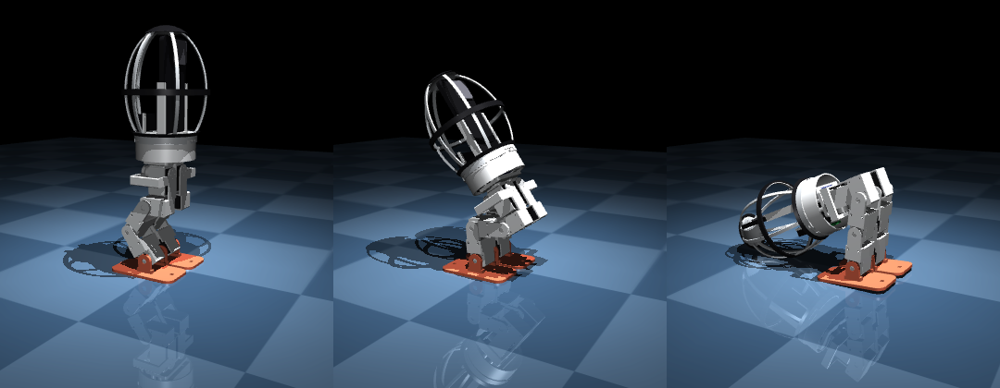

# sim/playground — política de caminhada (MuJoCo Playground / MJX)

Primeira política de locomoção do Cogu: **velocity tracking** (seguir um comando `vx, vy, ω_z`)
treinada com PPO (Brax) sobre MJX, no estilo dos envs de bípedes do MuJoCo Playground
(Berkeley Humanoid joystick) e do Open Duck Playground.

O modelo é o MJCF **gerado do CAD** — `build/mjcf/cogu_lower_body_mjx.xml` — nunca editado à mão.
Se o robô precisar mudar (kp, damping, alcance, massa), mude `cad/parameters.py` ou `cad/export.py`
e regenere com `uv run python -m cad.export`.

## Arquivos

| Arquivo | O que faz |
|---|---|
| `cogu_env.py` | Env `CoguJoystick(mjx_env.MjxEnv)`: observações, recompensa, terminação, latência do atuador, empurrões |
| `randomize.py` | Domain randomization por env: atrito do chão, massas, carga extra na pelve, modelo do servo (atrito, inércia, kp/kv, torque de travamento com a tensão da bateria, amortecimento do motor), offset de pose |
| `train.py` | PPO (Brax) com seed fixa; salva checkpoints em `build/checkpoints/cogu_walk/<passo>/` e `progress.jsonl` |
| `rollout.py` | Roda a política a partir do keyframe `rest` com um comando fixo e grava `build/videos/walk.mp4` |
| `compare.py` | Compara checkpoints no modelo atual: distância em 8 s e taxa de queda sob empurrões |
| `colab_train.ipynb` | Treino em GPU NVIDIA no Google Colab: gera o modelo do CAD, treina, testa sim2sim, grava vídeo e devolve um zip com o checkpoint |
| `play.py` | Roda a política no **viewer do MuJoCo**, comandada pelo teclado, no MuJoCo normal (sim2sim). `--follow` acompanha um treino em andamento |
| `command_tracking.py` | Quanto a política segue cada comando (frente, trás, lado, giro, parado): velocidade atingida e, parado, tempo com pé no ar |
| `cogu_pose.py` | Env `CoguPose`: sentar e deitar sob comando, corrigindo um roteiro (seção "Sentar e deitar") |
| `pose_eval.py` | Sim2sim do sentar / levantar / deitar com empurrões, atrito, servo e atraso sorteados; `script` = o roteiro sozinho |
| `check_env.py` | Smoke test do env (CI): fica em pé 2 s, observações finitas, randomizer em lote |
| `jax_compat.py` | Shim: Brax 0.14.2 ainda chama `jax.device_put_replicated`, removido do namespace público no jax 0.10 |

## Modelo do servo (2026-10-30)

Até a v4, o servo simulado tinha torque máximo (±1,9 N·m) mas **velocidade ilimitada**. O STS3215 a 7,4 V é um
motor DC com redução 1:345 e malha de posição própria: o torque disponível cai linearmente até zero na
velocidade sem carga (4,72 rad/s). O MJCF agora monta isso com peças nativas do MuJoCo/MJX: atuador de posição
saturado em ±1,91 N·m (o PD da malha do servo) mais amortecimento de junta igual a torque de travamento ÷
velocidade sem carga, 0,40 N·m·s/rad (a força contraeletromotriz). Atrito de 0,05 N·m e inércia refletida de
0,01 kg·m² são estimativas, para medir num servo de verdade. Valores em `ServoSTS3215` (`cad/parameters.py`).

A v4 usava o joelho a 4 rad/s, o que um servo com carga não alcança. Neste modelo ela cai a 0,25 e 0,30 m/s e
segue os outros comandos com menos força. Esse é o motivo da v5.

**v5.** Mudanças no env: com comando zero a fase da marcha fica parada na posição inicial (os dois
pés no chão) e um custo novo cobra pé no ar (`feet_air_still`); o rastreamento ficou mais exigente
(`tracking_sigma` 0,05 → 0,02, giro 0,5 → 0,2), porque a v4 seguia só metade dos comandos de lado e de ré. Teste
local (`command_tracking.py`, modelo com o iPhone 15 Pro Max):

- do zero, 3 M passos: ficou parada com qualquer comando, sem nunca dar um passo. O servo realista deixa cada
  passo caro e ficar parado é um ótimo local;
- a partir da v4 (`--restore`), 2 M passos: 0,14 m/s a 0,15 pedido, 0,18 e 0,19 m/s a 0,25 e 0,30 sem cair
  (a v4 caía), pé a 22,5 mm, 0 % de pé no ar com comando zero (a v4: 40 %). Giro, ré e lado ainda fracos.

## Recuperar de empurrões: v6 e v7 (2026-10-31)

`push_recovery.py`: empurrão súbito (mudança de velocidade do corpo, como no treino) para frente / trás / lados,
de 0,2 a 0,6 m/s, parado e andando a 0,15 m/s; conta quantos de 40 o robô aguenta e quanto os pés se afastam.

| | v5 | v6 | v7 |
|---|---|---|---|
| Empurrões aguentados (de 40) | 20 | 20 | **21** |
| Parado e empurrado: distância entre os pés | 55 mm (não pisa) | 55 mm | **62–111 mm (pisa)** |
| Parado, para frente | cai a 0,4 | cai a 0,3 | **aguenta 0,4** |

- **v6** (30 M no Colab, a partir da v5): penalidades de "ficar parado" só com o corpo devagar, empurrões até
  0,6 m/s. Não aprendeu o passo de recuperação: com comando zero o relógio da marcha ficava parado e as
  recompensas de passo desligadas, então pisar nunca valia nada.
- **v7** (30 M no Colab, a partir da v5): um empurrão que a IMU sente (giro > 0,6 rad/s ou inclinação > 9°) liga o
  relógio da marcha e as recompensas de passo por 1 s, mesmo com comando zero. Agora ela pisa para se recuperar;
  ainda cai para trás a 0,3 m/s e com 0,5 m/s ou mais em qualquer direção, perto do limite do servo realista.
  Checkpoint em `checkpoints/cogu_walk_v7` (o download do Colab tinha chegado em `build/`; refeito o teste de
  empurrão aqui: 21/40, igual ao Colab). Vídeo: `docs/renders/sim_walk_v7.mp4`.

## Levantar (2026-10-31)

`cogu_getup.py` + `train.py --env getup` + modelo `cogu_lower_body_mjx_getup.xml` (bolha, tambor e pernas tocam
o chão) + `getup_eval.py` + `play.py --getup` (troca sozinho entre levantar e andar). Ainda não levanta:

- 1ª versão (ação na faixa inteira de cada junta): nem os episódios que começam em pé ficavam em pé;
- ação como desvio da pose de repouso, saída inicial ~0, ruído 0,3 (na verdade ignorado: ver v2 abaixo), currículo de inícios (em pé / inclinado /
  deitado), avaliação sem ruído: no início do treino 32 % do tempo em pé (quem começa em pé fica), mas o treino
  (11 M no Colab) desaprende — 0,9 %. Com o ruído do treino, quem está em pé cai do mesmo jeito, deitado é um
  estado estável que paga razoável, e o horizonte do desconto (0,97: ~0,7 s) é curto para uma manobra de
  segundos.

### Estudo de viabilidade (2026-10-31): com as pernas atuais, não

`getup_search.py` (CPU, ~60 ms por simulação, 9 núcleos) deita o robô de frente, de costas ou de lado e procura
com CMA-ES uma sequência de 3–9 poses (alvos em toda a faixa das juntas + duração de cada uma), avaliada em três
variações de atrito e força do servo. Resultados:

- **Busca aberta: zero levantadas.** 10 800 sequências aleatórias e todas as rodadas de CMA-ES (4 posições,
  3–9 poses, com e sem partida de sequências boas) terminam deitadas. O impulso mais forte que existe deixa a
  pelve, por um instante, a ~53–58° do vertical (up_z 0,52–0,60) e o robô cai de volta.
- **Análise quase estática** (para cada inclinação do corpo, existe pose das pernas em que o centro de massa
  fica sobre os apoios, sem passar do stall?): em pé só nos pés, ele se equilibra até ~50° inclinado para a frente
  ou ~60° para trás; apoiado em bolha + pés, só a partir de ~80°. **Entre ~60° e ~75° nenhuma combinação de apoios
  (pés, bolha, tambor, coxas ou canelas) segura o robô** — levantar exigiria arremessar o corpo por essa faixa e
  pará-lo em equilíbrio, e a busca não achou como. Torque não é o limite: as poses de apoio pedem 0,1–0,5 N·m.
- **A ideia de encolher as pernas e escorar na bolha** funciona até a metade: de costas, puxando as coxas para trás,
  ele ergue o quadril acima da bolha (até ~110°, bolha + pés, ~0,2 N·m) — vídeo `build/getup_search/back_propped_heel30.mp4`.
  De frente não dá: o quadril só vai 15° para a frente (a carcaça da coxa encosta na viga do quadril). A volta
  para o vertical passa pela faixa sem apoio.
- **O que fecha a faixa:** um **calcanhar** mais longo. Com a sola 30 mm mais comprida para trás, há pose só nos
  pés até 75° e bolha + pés a partir de 78° (de costas); 45 mm dá folga. Joelho até −25° ou tornozelo até ±80°
  (faixas que o CAD mede como livres) sozinhos não fecham. Mesmo com o calcanhar, a sequência aberta ainda não
  levanta: falta a troca de apoio (a bolha sai do chão quando o peso passa para os pés), que provavelmente pede
  realimentação (RL), não sequência fixa.

```bash
uv run python sim/playground/getup_search.py --pose back --keyframes 5 --generations 300
uv run python sim/playground/getup_search.py --objective peak            # o mais em pé que cada posição alcança
uv run mjpython sim/playground/getup_search.py --view build/getup_search/*_peak.json
```

### Calcanhar e impulso + equilíbrio (2026-10-31, segunda rodada)

`getup_static.py` mapeia, numa grade (inclinação × quadril × joelho × tornozelo, as duas pernas iguais), todas
as poses em que o robô fica parado sobre seus apoios, e procura caminhos entre poses vizinhas. A "janela de
pouso" é a maior inclinação em que só os pés seguram o robô e de onde um caminho lento leva a `rest`:

| Calcanhar (sola mais longa para trás) | 0 mm (atual) | 30 mm | 45 mm | 60 mm |
|---|---|---|---|---|
| janela de pouso (estática) | 55° | 65° | 75° | 80° |

No simulador dinâmico a janela é ~10° menor: com 60 mm, posto sobre os pés a 70° (ou 60°), o caminho lento em
rampa (0,5–2 s por 10°) o deixa em pé, pelve a 203 mm; a 80° ele cai de volta na bolha. **Nenhum calcanhar (até
90 mm) dá caminho lento a partir de deitado**: passar o peso da bolha para os pés pediria os pés atrás e acima do
quadril (~−120° de quadril; a junta vai a −85°). Então levantar = um impulso que pousa nos pés + um controle que
segura.

- O impulso existe: buscas com objetivo "em pé só nos pés" (`--objective land`) chegam a up_z 0,62 (52°) no
  robô atual; com o calcanhar de 60 mm o corpo passa por up_z 0,89 (27°) por um instante. Força sobra.
- Sequência fixa não segura (o momento certo varia com atrito e servo). Passar para a v7 no pouso
  (`getup_handoff.py`) também não: a v7 foi treinada até 60° de inclinação e nunca viu um pouso desses.

Próximo passo: uma política de levantar treinada com esses pousos como ponto de partida (currículo: começar sobre
os pés a 30–60°, depois do impulso, depois deitado), comparando o pé atual com o calcanhar de 45 mm antes de mudar
o pé no CAD.

```bash
uv run python sim/playground/getup_static.py --xml build/mjcf/variants/heel_45.xml --out build/getup_search/path_heel45.json
uv run python sim/playground/getup_search.py --pose back --objective land --keyframes 3
uv run python sim/playground/getup_handoff.py build/getup_search/back_land.json
```

(As variantes `build/mjcf/variants/heel_*.xml` são o MJCF de get-up com a caixa da sola alongada para trás,
geradas com `MjSpec`; o CAD do pé não mudou.)

### Política de levantar v2: pousos como ponto de partida (2026-10-31)

- **O bug que derrubava todos os treinos de levantar:** a política padrão do brax (`tanh_normal`) ignora
  `init_noise_std` e a inicialização da média — o ruído de exploração era ~0,7 rad, não 0,3. Com a ação zero
  (pose `rest`) mais ruído, o robô em pé ainda está de pé após 6 s em 100 % das vezes com 0,05, 84 % com 0,1, 3 %
  com 0,15 e 0 % com 0,3. Todo treino, mesmo só com partidas em pé, deitava em 0,2 M passos. Agora a política é
  `normal` com log-desvio aprendido a partir de 0,05 (a ação é cortada em ±1 no ambiente), entropia 1e-4, desconto
  0,99; em 0,4 M passos locais quem começa em pé continua 100 % em pé.
- **Partidas** (`start_mix`): em pé 10 %, inclinado em `rest` 10 %, **sobre os pés inclinado 35 %**, **no meio do
  impulso 20 %**, deitado após queda 25 %. As duas novas vêm de `getup_starts.py`: poses do mapa quase estático em
  que só os pés seguram e há caminho lento até `rest` (15°–55° de costas / 40° de frente no pé atual; até 75° com
  o calcanhar de 45 mm), e instantâneos das sequências de impulso de `getup_sequences/` quando a pelve passa de
  up_z 0,3. O treino mostra o % do tempo em pé por tipo de partida.
- Recompensa de altura agora `((h − 0,07)/(0,20 − 0,07))²` (peso 2): a linear pagava 65 % a um agachamento.
- O auto-reset do Playground não reinicia o `info`: o filtro e a fila de atraso agora recomeçam da pose inicial no
  primeiro passo de cada episódio.
- Calcanhar sem mexer no CAD: `variants.py --heel 45` (no notebook, `HEEL = 45`).

```bash
uv run python sim/playground/variants.py --heel 45
uv run python sim/playground/getup_starts.py --xml build/mjcf/variants/heel_45.xml
uv run python sim/playground/train.py --env getup --xml build/mjcf/variants/heel_45.xml --steps 2000000
uv run python sim/playground/getup_eval.py CKPT --xml build/mjcf/variants/heel_45.xml --starts feet throw drop
```

**Resultado (2026-11-01): não aprendeu a levantar.** 50 M passos no Colab para cada pé (T4, 4096 robôs, 74 min,
11,3 mil passos/s), do zero, `cogu_getup_v2` e `cogu_getup_v2_heel45` (só em `build/checkpoints/`, não
versionados). % do tempo em pé por partida, no treino:

| Partida | Pé atual, 0 → 50 M | Calcanhar 45 mm, 0 → 50 M |
|---|---|---|
| Em pé | 100 → 90 | 100 → 100 |
| Inclinado em `rest` | 9 → 1 | 9 → 1 |
| Sobre os pés inclinado | 33 → 4 | 25 → 30 (máx. 33) |
| Meio do impulso | 0 → 0 | 0 → 0 |
| Deitado após queda | 0 → 0 | 0 → 0 |

`getup_eval.py`, 20 tentativas no MuJoCo normal: sobre os pés 1 de 20 (pé atual) e 6 de 20 (calcanhar); do impulso
e deitado, 0 de 20 nos dois. O mesmo que os treinos locais de 2 M passos (5 e 3 de 20 sobre os pés).

- O conserto do ruído funcionou para ficar em pé (o pé atual ainda escorrega para 65–90 % no fim), mas nenhuma
  política ficou melhor que a ação zero: as partidas sobre os pés já davam 25–33 % no passo 0, ficando parado.
- Com ruído 0,05 a exploração não descobre o impulso + pegada; com ruído maior o robô em pé cai (tabela acima).
  Mais passos do mesmo PPO não resolvem: levantar precisa de uma referência de movimento.
- O calcanhar de 45 mm segura melhor as partidas sobre os pés (30 % vs 4 % no fim, 6 vs 1 de 20), coerente com a
  janela estática maior (até 75°). Não muda nada no impulso nem deitado.

### Força, pescoço, joelhos e pegada roteirizada (2026-11-01)

Antes de treinar por imitação, testes no MuJoCo normal do que limita o levantar. Variantes por `variants.py`
(`--servo`, `--neck`, `--knee-max`, além de `--heel`; o CAD não muda). Ver os treinos no viewer:
`uv run mjpython sim/playground/getup_eval.py CKPT --starts feet throw drop --view`.

- **Força não é o limite.** Busca de impulso de costas (`getup_search.py --objective land`, 3 poses, 120 gerações),
  o quanto o robô pousa em pé só sobre os pés (up_z): atual 0,56–0,58; servo ×1,5 0,56; ×2 0,61–0,64; pescoço
  ±60° com a massa do celular (250 g) 0,52–0,55; calcanhar 45 mm 0,57–0,58; calcanhar 45 + pescoço 0,65–0,69. Os
  impulsos salvos saturam algum servo em 30 % do tempo, mas servos mais fortes não pousam mais em pé.
- **Joelho até 130°** (o CAD permite 95°: as abas da canela batem na coxa) não muda o mapa estático: janela de
  pouso de 55° (pé atual) e 75° (calcanhar 45), sem apoio entre 60° e 75° no pé atual.
- **De joelhos não é atalho.** Separando o mapa estático em ilhas de poses ligadas: existem poses de joelhos estáveis
  (de bruços, canelas + pés, 5–35°, pelve até 190 mm), mas isoladas: de bruços o mais perto de deitado que segura é
  75–80° (tambor + pés), um salto de ~40° até a ilha de joelhos e de ~35° até em pé sobre os pés.
- **Levantar de costas pede pernas assimétricas.** Os melhores impulsos usam uma perna a −82° de quadril e a outra
  a −6°, com o hip roll a ±35°: o robô sai meio de lado, rolando na borda da bolha. Com as duas pernas iguais
  (`getup_reference.py --search`, impulso + pegada, 600 candidatos × 3 variações) o pico é up_z 0,24 e nada levanta.
  O mapa estático, que só considera pernas iguais, não vê esse caminho.
- **A pegada é o gargalo.** `getup_reference.py`: um controle roteirizado que, partindo das poses sobre os pés de
  `getup_starts`, lê a inclinação e anda devagar pelo caminho estático até `rest` (de costas e de bruços). Melhor
  ajuste (1 rad/s, 10° à frente): **17 %** em pé no pé atual, **40 %** com o calcanhar de 45 mm (ficar parado em
  `rest`: 15 % e 23 %). As poses "estáveis" do mapa têm 5 mm de margem: o pé tem 65 × 52 mm e o centro de massa está
  a 191 mm do chão. A base de apoio é pequena demais para pegar o pouso com folga.

### Levantar v3: o RL corrige a pegada roteirizada (2026-11-01)

No pé do CAD (130 × 67 mm). Em vez de começar do zero, a política soma uma correção a um controle roteirizado
(`cogu_getup.py`, `reference`): a cada passo a inclinação da pelve (pela gravidade do IMU) escolhe uma pose no
caminho de pegada que `getup_starts.py` agora salva junto das partidas (o caminho estático lento da borda da janela
até `rest`, de costas e de bruços, terminando no próprio `rest`), 10° à frente; a referência anda até ela a no
máximo 1 rad/s por junta, e o alvo é a referência + ação × 1 rad. A referência entra na observação (46). Ação zero =
a pegada de `getup_reference.py`. `play.py` / `getup_eval.py` refazem a mesma conta em numpy (`getup_eval` agora passa
para a marcha v10).

No passo 0 (só a referência), sobre os pés: 42 % do tempo em pé no treino e **12 de 30** no `getup_eval` (a v2 do
zero: 1 de 20 no pé antigo, 6 de 20 com o calcanhar). Do impulso e deitado, 0: a referência só pega, o impulso tem que
vir do RL. 1 M passos locais não mudam isso (12 de 30; 0 e 0).

**v3 no Colab** (`checkpoints/cogu_getup_v3/`: 50 M passos, T4). `getup_eval`, 100 pousos sobre os pés (semente 1):

| Política | Sobre os pés | Mediana / mais lento |
|---|---|---|
| passo ~0 (`v3_smoke`, só a referência) | 35 de 100 | 1,5 s / 2,4 s |
| 1 M passos locais | 43 de 100 | 1,6 s / 2,9 s |
| **v3, 50 M passos** | **53 de 100** | 1,4 s / 2,6 s |

- **A correção do RL ajuda na pegada:** 35 → 53 de 100 (30 tentativas: 12 → 17). No modelo completo (contato
  de malha em tudo, `--xml build/mjcf/cogu_lower_body.xml --table` com as partidas do MJX): 46 de 100.
- **Impulso e deitado continuam em 0** (30 de cada, e 0 também no treino): a política não descobre o impulso
  sozinha nem com 1 rad de folga sobre a referência. O tempo em pé no treino fica estável (sobre os pés oscila entre 55 e 85
  de 500 passos); o RL só refina a pegada.
- Próximo passo para o impulso: pôr um impulso roteirizado (os assimétricos de `getup_search.py`) também na referência,
  como foi feito com a pegada.

### Levantar v4: impulso roteirizado + pegada (2026-11-02)

**Os impulsos salvos não servem no pé do CAD.** Seguidos da pegada do ambiente (gatilho por inclinação, como o
ambiente faz, sem sensor de contato), os três impulsos "land" sobem até up_z 0,47–0,51 (~60°) e caem de costas: 0 de
75 (3 impulsos × 5 gatilhos × 5 variações). Uma pegada mais rápida depois do impulso (3, 6, 20 rad/s) também não pega.

**Busca nova, impulso + pegada juntos** (`getup_reference.py --search --full --path starts`): CMA-ES sobre o impulso
nas 10 juntas (assimétrico, como `getup_search.py`) e a inclinação em que a pegada assume, seguida da pegada do
ambiente (lead 10°, 1 rad/s), nas 3 variações de atrito / servo. A nota soma o tempo só sobre os pés (até 2 s); sem
esse termo a busca preferia terminar de bruços. A busca salva o melhor a cada 20 gerações, e
`getup_reference.py --view --seq <arquivo> --path starts` (mjpython) repete o impulso + pegada relendo o arquivo:
dá para ver uma busca rodando.

| Lado | Quadros | Gatilho | Pico up_z | Só nos pés | Levanta |
|---|---|---|---|---|---|
| Costas (`getup_sequences/throw_back.json`) | 4 (2,35 s) | 49° | 0,51–0,53 (~58°) | 0,5–0,6 s | 0 de 5 variações |
| Bruços (`getup_sequences/throw_front.json`) | 4 (2,58 s) | 46° | 0,33 (~71°) | 0,6–0,7 s | 0 de 3 |

Nenhum levanta sozinho, mas os dois põem o robô só sobre os pés por meio segundo; a correção do RL faz o resto, como
na pegada (35 → 53 de 100 no v3).

**Ambiente v4** (`cogu_getup.py`, `reference.throw`): deitado (|inclinação| acima de 80° e do gatilho + 5°) por
0,3 s, a referência toca o impulso daquele lado (costas ou bruços pelo sinal da inclinação) quadro a quadro e passa
para a pegada quando a inclinação cruza o gatilho ou o impulso acaba; se cair deitado de novo, tenta outra vez. As
partidas "impulso" de `getup_starts.py` agora são instantâneos desses dois impulsos (75 estados) e guardam o momento
do impulso (`throw_t`, `throw_side`), onde a referência do ambiente começa. Observação 48 (+ impulsando, fração do
impulso). `play.py` e `getup_eval.py` espelham tudo; checkpoints v3 continuam rodando (sem impulso). Só a referência,
256 episódios: deitado → impulsa em 72 % (antes da busca de bruços); sobre os pés 24 % do tempo em pé no passo 0
(igual ao v3). 1 M passos locais: sobre os pés 2 de 10 no `getup_eval`, impulso e deitado 0.

**Resultado do Colab (50 M passos, T4): o v4 piorou, o v3 continua publicado.** `getup_eval.py`, mesmo modelo MJX:

| Partida | v3 | **v4** |
|---|---|---|
| sobre os pés (100, `--seed 1`) | 53 | **39** |
| sobre os pés / impulso / deitado (30 cada) | — | 14 / 0 / 0 |

O que acontece no impulso (20 partidas de cada, 10 s; script de diagnóstico, não versionado):

| | Impulsos por partida | Pico up_z (mediana / máx.) | Tempo com up_z > 0,8 |
|---|---|---|---|
| deitado, com a política | 3,5 | 0,34 / 0,47 | 0 |
| deitado, só a referência | 4,0 | 0,39 / 0,53 | 0 |
| meio do impulso, com a política | 2,5 | 0,35 / 0,52 | 0 |
| meio do impulso, só a referência | 3,0 | 0,49 / 0,52 | 0 |

O impulso dispara e repete, mas nunca passa de up_z 0,53 (~58°), e a correção do RL deixa o impulso **mais fraco**,
não mais forte. Como nenhum episódio chega em pé partindo deitado, a recompensa não mostra para que lado melhorar
o impulso. Além disso, o RL dividiu a capacidade entre impulso e pegada, e a pegada sobre os pés caiu de 53 para 39.
O checkpoint ficou só em `build/checkpoints/cogu_getup_v4` (não publicado).

**Ideias testadas na pegada roteirizada** (120 pousos sobre os pés, `rest` em 5 s):

| Pegada | Nominal | Escorregadio + fraco |
|---|---|---|
| como está | 39 % | 39 % |
| pernas abertas (quadril roll para fora) 10° / 20° / 30° | 34 / 26 / 27 % | 35 / 25 / 22 % |
| pontas para baixo 10° / 20° | 23 / 0 % | 26 / 0 % |
| pontas para cima 10° / 20° | 0 / 0 % | 0 / 0 % |

Fixas, pioram: sem roll no tornozelo, abrir a perna inclina a sola (apoio na borda); e caindo para trás o apoio já
está no calcanhar. O RL pode usar as duas por um instante (ele soma até 1 rad em todas as juntas).
`getup_reference.Reference(splay=...)` ficou para testes.

**Por que precisa de impulso:** deitado de costas, varrendo quadril / joelho / tornozelo, a sola chega no máximo a
6,8 cm do centro de massa (do lado das pernas: o quadril dobra só até 85°). Empurrar o chão gira o corpo em volta da
bolha e o centro de massa fica atrás dos pés: força não resolve (servo ×2: pouso 0,61–0,64 contra 0,56–0,58), o corpo
tem que passar por cima dos pés com velocidade. Quadril além de 85° mudaria isso (CAD).

### Estudo do quadril: coxa mais para trás (2026-11-02)

`hip_study.py`: o modelo de levantar com o limite de trás do quadril (hip pitch) em −100 … −140° em vez dos −85° do
CAD (`variants.py --hip-min`, só no simulador). Para cada um: o mapa quase estático e 120 quedas aleatórias (como
`getup_eval drop`, 40 em cada uma das 3 variações de piso / servo). **Sem impulso:** as pernas voltam a `rest`
(com as pernas recolhidas, a bolha rola o robô até ficar deitado de costas certinho), depois a pegada lenta do
`getup_reference.py` anda pelo caminho estático do próprio modelo (10° à frente, 1 rad/s).

| Quadril até | Janela costas / bruços | Em pé após a queda | Caiu de costas | De bruços | De lado |
|---|---|---|---|---|---|
| −85° (CAD) | 75° / 50° | 0/120 | 0/32 | 0/43 | 0/45 |
| −100° | 85° / 45° | 0/120 | 0/31 | 0/51 | 0/38 |
| −110° | 90° / 45° | 0/120 | 0/30 | 0/56 | 0/34 |
| −115° | 100° / 45° | 0/120 | 0/26 | 0/57 | 0/37 |
| **−120°** | 105° / 45° | 25/120 | **23/23** | 0/54 | 2/43 |
| −130° | 110° / 45° | 18/120 | 18/18 | 0/63 | 0/39 |
| −140° | 105° / 45° | 17/120 | 16/16 | 0/59 | 1/45 |

- **A partir de −120° o robô deitado de costas levanta devagar, sem impulso, em todas as quedas e variações.** Com
  a coxa a −120°, os pés chegam por baixo do centro de massa com o robô ainda deitado: a janela "só nos pés" passa de
  75° para 105° (além da horizontal). O limite é nítido: −115° dá 0. O caminho pede no máximo ~0,6 N·m por junta
  (stall 1,9).
- **De bruços e de lado: rolar primeiro.** `--search-roll front` / `left`: CMA-ES de 3 quadros, como
  `getup_search.py`, que deixa o robô deitado de costas. O rolamento de lado vale para os dois lados (espelhado);
  os rolamentos foram buscados no −120° e reusados no −130° e −140°. Com `--roll`:

| Quadril até | Em pé após a queda | De costas | De bruços | De lado |
|---|---|---|---|---|
| −120° | **88/120** | 23/23 | 26/54 | 39/43 |
| −130° | 86/120 | 18/18 | 34/63 | 34/39 |
| −140° | 88/120 | 16/16 | 31/59 | 41/45 |

  Os rolamentos são em malha aberta, roteiros fixos (o de bruços falha em metade das quedas e com servo a 70 %); com
  o v3 e o v4, partindo deitado, eram 0. Vídeo: `docs/renders/sim_getup_hip120.mp4` (costas, bruços, lado; ver
  ao vivo: `uv run mjpython sim/playground/hip_study.py --hip -120 --view`).

**No CAD a coxa bate na peça do roll a partir de −95°.** `cad/check_envelopes`-style, sólidos exatos: entre −95° e
−135° só a coxa contra o braço de trás do U do roll (o braço do rolamento do roll e o bloco que o liga à viga do
servo do quadril), 12–19 mm atrás do eixo do quadril e de 7 mm acima dele até o eixo do roll (32 mm acima); a peça
do yaw entra a −140° e a bolha só a −170°. A coxa (30 mm de largura) passa inteira pela largura do braço, então um
chanfro não resolve. Abaixar o eixo do quadril não compensa: 25 mm mais baixo (pilha do quadril de 81 para 106 mm)
libera só até −120°, sem a margem de 3° do `check_envelopes`. Chegar a −120…−125° pede redesenhar a ligação
roll → quadril (o braço de trás do U não pode descer atrás do eixo do quadril): decisão de CAD.

**CAD atualizado (2026-11-02, `docs/decisions/ADR-003-hip-pitch-120.md`): o quadril vai a −120°.** O braço de trás
do U só envolve o rolamento e se liga ao da frente por uma ponte lateral por fora (5 × 16 mm, na altura do eixo do
roll), em vez de descer até a viga. Os eixos não mudam de lugar. `check_envelopes`: livre de −135 a +20°;
com a perna esticada o pé encosta no tambor a partir de −130°. Render: `docs/renders/cad_hip_pitch_-120.png`. No
modelo novo, o levantar v8 segue 30/30 em cada partida e 99–100 de 100 quedas, e a marcha v10 aguenta 38 de 40
empurrões. As variantes `hip_-120` agora são iguais ao CAD.

**Levantar v5 no quadril −120° (2026-11-02, só no simulador).** `cogu_getup.py`, `reference.roll` (sem impulso):
deitado por 0,3 s, a referência relaxa as pernas até `rest` (2,5 s a 1 rad/s), lê como o robô ficou (pelo IMU) e,
de bruços ou de lado, toca o rolamento até ficar de costas (`getup_sequences/roll_front.json`, `roll_side.json` e
o espelho); de costas, vai direto para a pegada, cujo caminho agora começa em 105° (ainda deitado). Caindo de costas
de novo, a pegada continua; de outro jeito, recomeça. As partidas "impulso" viram instantâneos dos rolamentos
(`getup_starts.py --mode roll`, o padrão), e a tabela de pés vai até 105°. Episódios de 15 s. Observação 48 (as
mesmas duas entradas: em sequência, fração feita). Notebook: `HIP = -120`, `NAME = "cogu_getup_v5"`.

Só a referência (ação zero), 512 episódios no MJX, em pé ao fim dos 15 s: em pé 100 %, inclinado 92 %, sobre os pés
82 %, meio do rolamento 100 %, **queda 76 %** (v4: 0). Treino local de 1 M passos (ainda com episódios de 10 s:
`train.py --episode-length` sobrescrevia o do env; agora o padrão é o do env), `getup_eval --seconds 15`, 10 de cada:
sobre os pés 6, meio do rolamento 10, queda 6.

**Resultado do Colab (50 M passos, T4, ~70 min de treino): levanta de quase qualquer queda.** Publicado em
`checkpoints/cogu_getup_v5/`. `getup_eval.py --seconds 15`, modelo de treino (`hip_-120`):

| Partida | v3 (CAD, −85°) | Só a referência v5 | **v5** |
|---|---|---|---|
| sobre os pés (30) | 53 de 100 | 20 de 30 | **30 de 30** |
| meio do rolamento (30) | — | — | **30 de 30** |
| queda (30 / 100, `--seed 1`) | 0 | 81 de 100 | **30 de 30 / 97 de 100** |

Leva ~10 s (relaxar 2,5 s, rolar 3,5 s, subir ~4 s). No modelo completo (malha de contato em tudo,
`variants.py --hip-min -120 --src build/mjcf/cogu_lower_body.xml`), mais difícil: sobre os pés 10 de 30, meio do
rolamento 23 de 30, queda 6 de 30. A diferença vem dos contatos simplificados do modelo de treino (caixa na sola,
bolha e tambor em formas simples); as partidas "sobre os pés" ainda vêm da tabela do modelo de treino. Vídeo de 4
quedas: `docs/renders/sim_getup_v5.mp4` (`getup_eval.py ... --video`). Tudo isso supõe o quadril a −120°, que o CAD
ainda não permite.

**Levantar v6: a política aprendeu os contatos simplificados (2026-11-02).** Quedas (30, `getup_eval --starts drop`),
política v5 e a referência sozinha, trocando uma coisa de cada vez:

| Modelo | v5 | Só a referência |
|---|---|---|
| treino (`hip_-120`) | 29 | 27 (81 de 100) |
| completo (malha de contato em tudo) | 6 | **26** |
| treino, bolha com atrito 0,4 / sem caixas nas pernas / pernas 70 % / sem tambor / solver do completo | 29 / 29 / 29 / 29 / 29 | |
| completo, sola em caixa / bolha a 0,8 / sem a faixa de TPU / sem colisão entre peças | 13 / 11 / 7 / 2 | |
| completo, um atrito para tudo 0,6 / 0,8 / 0,9 / 1,0 | 12 / 13 / 12 / 12 | |
| completo com as formas do treino (sola, bolha, tambor, caixas) | 11 | |
| idem, com os bits de contato e o atrito do piso do treino | 29 | |

Nenhuma diferença sozinha explica; somadas, sim. A política corrige pouco (0,07 rad em média por junta, p95 0,17),
mas essas correções dependem dos contatos exatos do modelo de treino. Na falha típica no modelo completo, o robô para
de bruços sobre os pés e a faixa de TPU, inclinado ~82°, e o rolamento de bruços se repete sem sucesso. A referência
sozinha não cai nisso. Por isso o v6:

- **Formas de contato variadas** (`randomize.py`, só no modelo de levantar): a cada ambiente, a bolha (×0,92–1,05),
  o tambor (×0,9–1,05), as solas (×0,85–1,05) e as caixas das pernas (×0,7–1,05), por eixo, e as posições delas
  ±5 mm. O atrito do piso já variava de 0,4 a 1,0.
- **A correção custa um pouco:** `residual` −0,5 × Σ ação filtrada² (fica perto da referência, que funciona nos dois
  modelos).
- A partir do v5, 30 M passos. O notebook agora testa também no modelo completo (célula 6).

**Resultado do Colab (30 M passos, T4, ~52 min): melhora pouco no modelo completo.** Publicado em
`checkpoints/cogu_getup_v6/` (é melhor que o v5 nos dois modelos). `getup_eval.py --seconds 15`, 30 de cada
(sobre os pés / meio do rolamento / queda) e 100 quedas `--seed 1`:

| | modelo de treino | 100 quedas | modelo completo | 100 quedas |
|---|---|---|---|---|
| v5 | 30 / 30 / 30 | 97 | 10 / 23 / 6 | |
| **v6** | 30 / 30 / 30 | **98** | 15 / 25 / 8 | 31 |
| v6 sem correção ao relaxar e rolar (`--scripted-residual off`) | 25 / 30 / 25 | | **19 / 27 / 23** | |
| v5 idem | 24 / 30 / 28 | | 13 / 25 / 11 | |
| só a referência | 20 / 30 / 25 | | 17 / 30 / 22 | |

Todas as quedas que falham no completo terminam iguais: de bruços, inclinado 81°, pélvis a 57 mm. Seguindo uma
delas: enquanto a referência relaxa as pernas, a correção do v6 (0,07 rad em média, 0,17 no máximo) deixa o robô
deitado um pouco diferente (pélvis 58 mm e −81,7° contra 64 mm e −84,5° só com a referência); daí o rolamento de
bruços, que é um roteiro fixo, tomba para o lado e volta de bruços, e tudo se repete. Só com a referência, o mesmo
rolamento vira de costas e ele levanta em 11 s. Com metade da correção ainda são 12 de 30. A política aprendeu a
dobrar o relaxar e o rolar para os contatos do modelo de treino; na subida ela ajuda nos dois modelos.

**Levantar v7: sem correção nos roteiros.** `reference.scripted_residual` (novo, `False`): enquanto a referência
relaxa ou rola, a ação da política é ignorada (o filtro recomeça do zero na subida); `play.py` e `getup_eval.py`
fazem o mesmo, e checkpoints sem a chave (v5, v6) seguem corrigindo tudo. A partir do v6, 30 M passos
(notebook: `NAME = "cogu_getup_v7"`, `RESTORE = .../cogu_getup_v6`).

**Resultado do Colab (30 M passos, T4, ~54 min): a diferença entre os modelos quase fechou.** Publicado em
`checkpoints/cogu_getup_v7/`. `getup_eval.py --seconds 15`, 30 de cada (sobre os pés / meio do rolamento / queda) e
100 quedas `--seed 1`:

| | modelo de treino | 100 quedas | modelo completo | 100 quedas |
|---|---|---|---|---|
| v6 | 30 / 30 / 30 | **98** | 15 / 25 / 8 | 31 |
| v6 `--scripted-residual off` | 25 / 30 / 25 | | 19 / 27 / 23 | 63 |
| **v7** | 24 / 30 / 26 | 84 | **23 / 29 / 23** | **63** |
| só a referência | 20 / 30 / 25 | 81 | 17 / 30 / 22 | 67 |

De 98 contra 31 (v6) para 84 contra 63. Nas quedas o v7 fica no nível da referência sozinha nos dois modelos (o
limite agora são os rolamentos em malha aberta, que falham em ~1/3 das quedas); sobre os pés ele ajuda (23 contra 17
no completo). No modelo de treino, a maioria das quedas que falham termina em pé (up_z 0,96–0,98, pélvis 208 mm)
mas sem chegar a `rest` parado a tempo; no completo, metade fica deitada de bruços (pélvis 64 mm). O v6 continua
melhor no modelo de treino; o v7 é o que transfere, e é o mais perto do robô real.

**Rolar a partir de quedas reais (2026-11-02): ~100 % das quedas em pé nos dois modelos.** Os rolamentos (a manobra
de rolar de bruços ou de lado até ficar de costas) tinham sido buscados de uma única pose deitada; partindo das poses
reais (quedas como `getup_eval drop`, depois o relaxar do env), o de bruços, que é o caso mais comum (~57 % das
quedas), deixava de costas só 63 % (treino) e 70 % (completo). `roll_search.py`: um banco de 150 quedas relaxadas
por modelo, cada uma também com o atrito do piso ×0,7 e ×1,3; CMA-ES a partir do rolamento atual, cada geração
pontuada num sorteio de partidas dos dois modelos. Os novos estão em `getup_sequences/roll_front.json` e
`roll_side.json`. Em 150 quedas novas por modelo (`--check --seed 1`), de costas após rolar:

| | de bruços, treino | de bruços, completo | de lado, treino | de lado, completo |
|---|---|---|---|---|
| antes | 66 % | 64 % | 87 % | 100 % |
| **agora** | **97 %** | **100 %** | **96 %** | **100 %** |

Como o v7 não corrige os roteiros, ele pode tocar os novos sem treinar de novo (`--rolls DIR` no `play.py` e no
`getup_eval.py`; sem a opção, cada checkpoint toca os rolamentos com que treinou). `getup_eval --seconds 15`, v7:

| | modelo de treino | modelo completo |
|---|---|---|
| 100 quedas `--seed 1`, rolamentos antigos | 84 | 63 |
| 100 quedas `--seed 1`, **novos** (só a referência) | **98** (98) | **100** (100) |
| 100 quedas `--seed 2`, novos | 100 | 100 |
| sobre os pés (30), novos | 30 | 30 |

Leva ~10 s (mediana). Vídeo de 4 quedas no modelo completo: `docs/renders/sim_getup_rolls.mp4`. O notebook já
treina o v8 a partir do v7 com estes rolamentos (as partidas "meio do rolamento" passam a ser deles).

```bash
uv run python sim/playground/roll_search.py --check                     # rolamentos atuais, por pose e modelo
uv run python sim/playground/roll_search.py --search front              # -> build/roll_search/roll_front.json
uv run mjpython sim/playground/play.py --checkpoint sim/playground/checkpoints/cogu_walk_v10 \
    --getup sim/playground/checkpoints/cogu_getup_v7 --rolls sim/playground/getup_sequences \
    --xml build/mjcf/variants/hip_-120.xml                              # andar, empurrar, cair, levantar
```

**Levantar v8 (Colab, 30 M passos a partir do v7, já com estes rolamentos): levanta de praticamente toda queda nos
dois modelos.** Publicado em `checkpoints/cogu_getup_v8/`; os rolamentos novos estão salvos no checkpoint, então o
`play.py` não precisa de `--rolls`. `getup_eval.py --seconds 15` (tabela de partidas refeita com os novos):

| | modelo de treino | modelo completo |
|---|---|---|
| 30 de cada (sobre os pés / meio do rolamento / queda) | 30 / 30 / 30 | 30 / 30 / 30 |
| 100 quedas `--seed 1` / `--seed 2` | 99 / 100 | 100 / 100 |
| v7 `--rolls`, 30 de cada | 30 / 30 / 30 | 30 / 30 / 30 |
| v7 `--rolls`, 100 quedas `--seed 1` / `--seed 2` | 98 / 100 | 100 / 100 |

Igual ao v7 com os rolamentos novos, um pouco mais rápido sobre os pés (mediana 6,7 contra 8,3 s no treino, 8,7
contra 10,3 s no completo). Uma queda leva ~10 s (relaxar 2,5 s, rolar ~3,5 s, subir ~4 s). Ainda só no
simulador: o quadril a −120° não cabe no CAD (−85°).

```bash
uv run mjpython sim/playground/play.py --checkpoint sim/playground/checkpoints/cogu_walk_v10 \
    --getup sim/playground/checkpoints/cogu_getup_v8 --xml build/mjcf/variants/hip_-120.xml
```

```bash
uv run python sim/playground/variants.py --hip-min -120
uv run python sim/playground/getup_starts.py --xml build/mjcf/variants/hip_-120.xml
uv run python sim/playground/train.py --env getup --xml build/mjcf/variants/hip_-120.xml --steps 1000000
uv run python sim/playground/getup_eval.py CKPT --xml build/mjcf/variants/hip_-120.xml --starts feet throw drop --seconds 15
```

```bash
uv run python sim/playground/hip_study.py                                     # tabela sem rolar
uv run python sim/playground/hip_study.py --hip -120 --search-roll front      # e --search-roll left
uv run python sim/playground/hip_study.py --hip -120 -130 -140 --roll
```

### Estudo do pé (2026-11-01)

`foot_study.py`: para cada sola (calcanhar para trás, ponta para a frente, largura para fora, em mm; `variants.py`),
a janela de pouso estática, a pegada roteirizada a partir das poses sobre os pés daquela sola (80 pousos, nominal e
com piso escorregadio + servo fraco) e a marcha v7 **sem retreinar** (8 s, e os 40 empurrões de `push_recovery.py`).

| Pé (calcanhar, ponta, largura) | Sola (mm) | Janela costas / bruços | Pegada (costas / bruços) | Escorregadio + fraco | Marcha 0,15 / 0,25 / giro 8 s | Empurrões |
|---|---|---|---|---|---|---|
| atual | 65 × 52 | 55° / 35° | 25 % (31 / 18) | 30 % | 1,37 m / 1,78 m / 330° | 21/40 |
| 45, 0, 0 | 110 × 52 | 75° / 35° | 42 % (54 / 33) | 44 % | cai 2,1 s / cai 1,5 s / 302° | 14/40 |
| 30, 20, 0 | 115 × 52 | 65° / 45° | 39 % (52 / 24) | 41 % | 0,13 m / 0,24 m / −82° | 30/40 |
| 45, 20, 0 | 130 × 52 | 75° / 45° | 36 % (57 / 19) | 36 % | 0,08 m / cai 6,6 s / 229° | 30/40 |
| 60, 20, 0 | 145 × 52 | 80° / 45° | 39 % (52 / 24) | 40 % | 0,41 m / cai 4,1 s / 145° | 29/40 |
| 45, 40, 0 | 150 × 52 | 75° / 55° | 35 % (57 / 16) | 35 % | 0,85 m / 0,74 m / −18° | 30/40 |
| **45, 20, 15** | **130 × 67** | 75° / 45° | 36 % (57 / 19) | 36 % | 0,95 m / 0,33 m / 278° | **38/40** |
| 60, 40, 15 | 165 × 67 | 80° / 55° | 35 % (55 / 13) | 36 % | 0,59 m / 0,73 m / 225° | 37/40 |

- **A janela cresce com o pé:** de costas, de 55° para 75–80° com o calcanhar; de bruços, de 35° para 45–55° com
  a ponta.
- **A pegada roteirizada sobe de 25 % para 35–42 %** (de costas chega a 52–57 %). Cada sola é testada com os pousos
  dela, e um pé maior inclui pousos mais inclinados; por isso não sobe mais. Esse roteiro é cru (anda pelo caminho
  estático sem olhar velocidade): a pegada boa tem que vir do RL, e o pé maior dá a ela mais margem.
- **Empurrões:** a sola mais larga segura 37–38 de 40 com a mesma política v7 (atual: 21).
- **A marcha precisa ser retreinada para qualquer pé novo:** a v7 tropeça com a sola mais longa (só calcanhar: cai
  em 2 s). Isso mede a política, não o pé.

**Marcha v8 no pé 130 × 67 mm (45, 20, 15).** `checkpoints/cogu_walk_v8_foot/`: 30 M passos no Colab (T4, 27 min) a partir da
v7, no modelo de marcha com essa sola (`walk_heel45_toe20_width15.xml`). Sim2sim, 8 s a partir do repouso:

| Medida | v7 no pé atual | v7 no pé novo | **v8 no pé novo** |
|---|---|---|---|
| 0,15 m/s: distância / velocidade | 1,37 m / 0,18 | 0,95 m / 0,12 | 1,23 m / **0,16** |
| 0,25 / 0,30 m/s | 0,23 / 0,24 | 0,14 / 0,15 | 0,22 / 0,23 |
| ré 0,10 m/s | 0,09 | 0,02 | 0,09 |
| de lado ±0,10 m/s | 0,03 / 0,04 | 0,02 / 0,04 | 0,03 / 0,03 |
| giro ±0,6 / 1,0 rad/s | 0,56 / −0,57 / 0,86 | 0,47 / −0,34 / 0,78 | **0,58 / −0,60 / 0,87** |
| giro 8 s a 0,8 rad/s | 330° | 278° | **348°** |
| empurrões | 21/40 | 38/40 | **37/40** |
| parado: pé no ar | 0 % | 0 % | **46 %** |
| marcha a 0,15: pé / no ar / escorregão | 27 mm / 0,28 s / 0,010 | 13 mm / 0,06 s / 0,125 | 23 mm / 0,27 s / 0,013 |

- **O pé novo anda tão bem quanto o atual** (velocidades e giro iguais ou melhores, a deriva lateral da v7 sumiu) e
  **segura quase o dobro de empurrões** (37 contra 21).
- **Defeito novo: parado, ela marcha no lugar** (pé no ar 46 % do tempo com comando zero; a v7 fica de pé). Também
  a frequência medida pelo `gait_metrics.py` subiu para 3,6 Hz (mesmos 23 passos em 8 s; tremor 0,02).

**Por que a v8 marchava no lugar.** Desde a v7, um empurrão que o IMU sente (giro > 0,6 rad/s ou 9° de inclinação)
liga o relógio da marcha e as recompensas de passo por 1 s, mesmo com comando zero. A v8 aprendeu a se empurrar: com
comando zero ela balança o corpo nos primeiros 40 ms, o giro passa de 0,6 rad/s e o modo de recuperação fica ligado
para sempre (100 % do tempo no sim2sim, pé no ar 88 %; a v7 não passa de 0,34 rad/s parada). Correção no env
(v9): o relógio continua seguindo o IMU, como no robô, mas as recompensas de passo e a isenção de `stand_still` /
`feet_air_still` só valem até 2 s depois de um empurrão de verdade (`recover.push_credit`). Também `stand_still`
−1 → −2, `feet_air_still` −1 → −3 e comando zero em 20 % dos sorteios (era 10 %). Retreinar a v8 com isso não
desfez o vício em 1 M passos (local); partindo da v7 ele não aparece.

**Marcha v9 no pé novo.** `checkpoints/cogu_walk_v9_foot/`: 30 M passos no Colab (T4) a partir da v7, com o env
corrigido. Vídeo: `docs/renders/sim_walk_v9.mp4`. Mesmas medidas da tabela acima:

| Medida | v7 no pé atual | v8 no pé novo | **v9 no pé novo** |
|---|---|---|---|
| 0,15 m/s: distância / velocidade | 1,37 m / 0,18 | 1,23 m / 0,16 | **1,27 m / 0,16** |
| 0,25 / 0,30 m/s | 0,23 / 0,24 | 0,22 / 0,23 | 0,22 / 0,24 |
| ré 0,10 m/s | 0,09 | 0,09 | **0,11** |
| de lado ±0,10 m/s | 0,03 / 0,04 | 0,03 / 0,03 | 0,03 / 0,04 |
| giro ±0,6 / 1,0 rad/s | 0,56 / −0,57 / 0,86 | 0,58 / −0,60 / 0,87 | **0,64 / −0,61 / 0,97** |
| giro 8 s a 0,8 rad/s | 330° | 348° | **374°** |
| empurrões | 21/40 | 37/40 | **37/40** |
| parado: pé no ar | 0 % | 46 % | **0 %** |
| marcha a 0,15: pé / no ar / escorregão | 27 mm / 0,28 s / 0,010 | 23 mm / 0,27 s / 0,013 | 23 mm / 0,27 s / 0,016 |

A v9 fica parada como a v7, anda e gira tão bem ou melhor que a v8 e segura os mesmos 37 de 40 empurrões. O
`gait_metrics.py` ainda mede 3,6 Hz no pé novo (23 passos em 8 s, como a v7 no pé atual a 1,7 Hz): provavelmente a medida, não o
passo. Andar de lado continua fraco (um terço do pedido).

**O pé novo foi para o CAD** (`cad/parameters.py`: `FOOT_LENGTH` 130, `FOOT_WIDTH` 67, `FOOT_OUTSET` 7,5,
`ANKLE_X_FROM_HEEL` 67). A sola exportada é a mesma caixa da variante `walk_heel45_toe20_width15.xml`; o pé passou
de 15 para 34 g impressos e o robô de 1282 para 1320 g. A v9 no modelo do CAD: 1,27 m / 1,75 m / 376°, 38 de 40
empurrões. `variants.py` e `foot_study.py` agora somam ao pé novo (a coluna "atual" da tabela acima é o pé antigo).

**Marchando depois do empurrão.** Parada, um empurrão de 0,4 m/s ou mais deixava a v9 (e a v7) marchando no lugar para
sempre: os passos de recuperação mantêm o giro acima de 0,6 rad/s, cada leitura renovava a janela de 1 s e o relógio
da marcha nunca parava. Detector novo (`recover.latch`, v10): cada empurrão abre **uma** janela de 1,5 s que os passos
não renovam, e depois o detector descansa 1 s. A v9 com ele, sem retreino (`play.py --latch`): para de dar passos
1,6–1,7 s depois de qualquer empurrão parado (0,2 a 0,6 m/s, quatro direções) e continua segurando 38 de 40. Os
checkpoints até a v9 seguem com o detector antigo, a não ser com `--latch`; o env já treina com o novo.

**Marcha v10: pé do CAD e detector novo.** `checkpoints/cogu_walk_v10/`: 30 M passos no Colab (T4) a partir da v9, no
modelo exportado do CAD (pé de 34 g, robô de 1320 g), com `recover.latch`. Vídeo: `docs/renders/sim_walk_v10.mp4`.
Sim2sim no modelo do CAD, 8 s a partir do repouso:

| Medida | v9 (+ `--latch`) | **v10** |
|---|---|---|
| 0,15 m/s: distância / velocidade | 1,27 m / 0,16 | **1,30 m / 0,17** |
| 0,25 m/s em 8 s / 0,30 m/s | 1,75 m / 0,24 | **1,80 m / 0,25** |
| ré 0,10 m/s | 0,11 | 0,10 |
| de lado ±0,10 m/s | 0,03 / 0,04 | 0,03 / 0,02 |
| giro ±0,6 / 1,0 rad/s | 0,64 / −0,61 / 0,97 | 0,63 / −0,60 / 0,93 |
| giro 8 s a 0,8 rad/s | 376° | 369° |
| empurrões | 38/40 | **38/40** |
| parado: pé no ar | 0 % | 0 % |
| parado, empurrão 0,4–0,6 m/s: para de dar passos | 1,6–1,7 s | 1,6 s (cai só a 0,6 para a frente) |
| marcha a 0,15: pé / no ar / escorregão | 23 mm / 0,27 s / 0,016 | 22 mm / 0,27 s / **0,007** |

A v10 é a marcha atual: igual à v9 com `--latch`, um pouco mais rápida, escorrega metade, e o detector com que ela
treinou é o que ela usa. Andar de lado continua fraco.

## Sentar e deitar (2026-11-02)

Para os comandos "sente" e "deita" do bichinho (ADR-004): um roteiro que funciona sozinho e o ambiente `cogu_pose.py`
para treinar uma correção em volta dele, como no levantar.

**Sentar.** A ideia inicial era descer até a bolha encostar no chão, com o corpo em pé. Não dá: com a pelve em pé, as
coxas e os links do quadril batem no chão com a pelve a ~100 mm, e a bolha ainda está acima (mapa estático de
`getup_static.py` até 45° de inclinação: nenhuma pose com bolha e pés juntos). O que funciona é agachar sobre os pés
inclinando para trás. Com as solas no chão, a inclinação da pelve é `−(quadril + joelho + tornozelo)`, e o centro de
massa precisa ficar sobre a sola (130 mm). Descendo reto, ele sai pela ponta e o robô cai para a frente (pelve a
~172 mm). Inclinando para trás junto, cabe até o fim:

| joelho 90°, quadril −120° | inclinação 0° | 10° | 20° | 30° | **35°** | 40° |
|---|---|---|---|---|---|---|
| centro de massa à frente do meio da sola | +78 mm (cai) | +59 mm (na borda) | +38 mm | +16 mm | **+4 mm** | −7 mm |
| pelve | 129 mm | 144 mm | 156 mm | 163 mm | **166 mm** | 167 mm |

O roteiro vai de `rest` a quadril −120°, joelho 90° e 35° de inclinação em 2 s (perfil em cosseno), com o
tornozelo mantendo a sola no chão, e levanta pelo mesmo caminho. Sentado, a pelve fica a 165 mm e ele olha 35° para
cima, para o rosto de quem está em pé perto dele, como um pet sentado. O centro de massa fica quase sobre o
tornozelo, e a pose se segura com 0,02 N·m: os servos quase descansam.

A primeira versão sentava inclinada 20° (pelve 154 mm, 0,25 N·m). Um empurrão de 0,3 m/s para a frente já a derrubava
por cima da ponta do pé; para trás e de lado, aguentava 0,6. Inclinada 25° o limite para a frente sobe para 0,3 m/s;
30°, 0,4; 35°, 0,6 (cai a 0,8).

**Deitar.** De costas, pelo caminho da pegada do levantar tocado ao contrário: a cada passo a inclinação (do IMU)
escolhe a pose do caminho 10° mais deitada, alcançada a 1 rad/s. Toda pose desse caminho se segura sozinha, então ele
deita em ~2 s, sem passar de 0,1 m/s, em pé ou sentado. Para levantar, o levantar v8. A pose "chocando" (pernas dobradas
para trás sob o corpo, canelas no chão, corpo em pé, torque zero) existe parada, mas indo do sentado para ela o robô
tomba para trás (todas as variantes testadas).

**O roteiro sozinho**, `pose_eval.py script`: em pé → senta (segura 3 s) → levanta até ficar pronto para a marcha →
senta → deita. Atrito 0,6–1,2, servo 85–100 % e atraso de 0–40 ms sorteados, um empurrão em cada pausa; tentativas
que completam o ciclo inteiro:

| empurrão até | inclinado 20°: treino | completo | **inclinado 35°: treino** | **completo** |
|---|---|---|---|---|
| 0,25 m/s | 20/20 | 20/20 | | |
| 0,4 m/s | 16/20 | 15/20 | 20/20 | 20/20 |
| 0,6 m/s | 12/20 | 12/20 | 20/20 | 20/20 |
| 0,8 m/s | | | | 19/20 |
| 1,0 m/s | | | | 15/20 |

Quem cai, cai sentado: os empurrões fortes derrubam na pausa sentada, e quem senta inteiro levanta e deita sempre.
Sentado a 35°, ele aguenta mais que a marcha v10 em pé (0,5–0,6 m/s).

O ciclo inteiro com as outras políticas (`play.py`: marcha v10 → senta → levanta → anda → senta → deita → levantar v8 →
anda) funciona no modelo do treino, no completo e no apartamento (`sim/brain/apartment.py`).

**A política** (`--env pose`): ambiente de 12 s, o comando (em pé / sentado / deitado) muda a cada 1,5–4 s e `lie` é
final; começa em pé ou sentado, empurrões de até 0,5 m/s em pé ou sentado. A ação corrige o roteiro (× 0,5 rad), com o
mesmo filtro e atraso da marcha. Recompensas: juntas perto do roteiro, inclinação e altura da pelve esperadas (deitado:
de costas, 112°), parado (velocidade da pelve), pés sem escorregar, e a correção pequena. Cai (mais de 40° fora da
inclinação esperada, em pé ou sentado): fim do episódio. Observação (51): IMU, juntas, última ação, comando, roteiro,
quanto já sentou e se está deitando.

**Pose v1** (Colab, T4, 30 M passos do zero, 51 min, sentando inclinada 20°): a curva ficou plana, com 0,14–0,20
quedas por episódio do começo ao fim. No sim2sim, com empurrões de até 0,4 m/s, ela completou 17/20 no modelo do
treino e 16/20 no completo, contra 16/20 e 15/20 do roteiro sozinho: empate dentro do ruído. O que derrubava era o
empurrão para a frente sentado inclinado 20°. Na física isso pede mudar a pose, não corrigir em volta dela, e os 35°
resolveram sem rede. O checkpoint não foi guardado.

**Decisão: o sentar e o deitar ficam como roteiro**, sem rede neural. Ele já aguenta mais que a marcha e, na medula, é
mais barato que uma rede: são poucas contas por passo no ESP32. O ambiente e o `--env pose` ficam para quando o servo real
for medido. Se o roteiro piorar com o modelo do servo medido, treina-se a correção (pose v2) a partir dele.

```bash
uv run python sim/playground/pose_eval.py script --xml build/mjcf/variants/full_hip_-120.xml   # o roteiro sozinho
uv run python sim/playground/train.py --env pose --steps 30000000 --num-envs 4096 ...             # Colab: ENV = "pose"
uv run mjpython sim/playground/play.py --checkpoint sim/playground/checkpoints/cogu_walk_v10 \
    --getup sim/playground/checkpoints/cogu_getup_v8 --pose script --xml build/mjcf/variants/hip_-120.xml
```

No viewer: **S** senta e levanta do sentado, **L** deita, **G** levanta de deitado (com `--getup`). `--pose script`
toca o roteiro sozinho; com um checkpoint, a política.



## Resultado v5 — servo realista, ficar parado, giro simétrico (2026-10-30)

`checkpoints/cogu_walk_v5/`: 30 M passos no Colab (T4, 4096 robôs, 26,5 min, 18,9 mil passos/s), partindo da v4,
no robô com o iPhone 15 Pro Max (1,28 kg) e o modelo de servo realista. Vídeo: `docs/renders/sim_walk_v5.mp4`.

`command_tracking.py` no MuJoCo normal (sim2sim), 8 s a partir da pose de repouso, sem quedas em nenhum comando:

| Comando | v4 (modelo novo) | **v5** |
|---|---|---|
| 0,15 m/s | 0,13 | **0,16** |
| 0,25 m/s | cai | **0,21** |
| 0,30 m/s | cai | **0,22** |
| ré 0,10 m/s | 0,02 | **0,07** |
| de lado 0,10 m/s | 0,02 / 0,01 | 0,03 / 0,03 |
| giro +0,6 / −0,6 rad/s | 0,42 / −0,30 | **0,56 / −0,59** |
| giro 1,0 rad/s | 0,54 | **0,75** |
| parado: pé no ar | 40 % | **0 %** |

`gait_metrics.py` a 0,15 m/s: 1,71 Hz, tremor 0,03, pé a 25 mm (26 / 24 mm), 46 / 49 % no ar, escorregão 0,010 m/s.
O giro ficou simétrico (o desvio para a esquerda sumiu) e a ré dobrou; andar de lado continua fraco (um terço do
pedido) — é o próximo ajuste da marcha.

## Resultado v4 — primeira marcha de verdade (2026-10-30)

`checkpoints/cogu_walk_v4/`: 50 M passos no Colab (GPU T4, 4096 robôs, 37 min, 22,7 mil passos/s), seed 0, no robô
com celular (ADR-002). Recompensas novas: filtro passa-baixa na ação (`action_filter_alpha` 0,4), cobranças de
suavidade, de pé escorregando, de pé baixo e de pé plantado, e mais peso para fase e tempo de voo. As versões
v0/v1 não davam passos: vibravam as pernas a 12,6 Hz e patinavam.

`gait_metrics.py` a 0,15 m/s, 8 s a partir da pose de repouso, no MuJoCo normal (sim2sim):

| Medida | v1 | **v4** | Uma marcha |
|---|---|---|---|
| Velocidade | 0,16 m/s | 0,16 m/s | 0,15 pedido |
| Frequência do passo | 12,6 Hz | **1,71 Hz** | 1,5–2,5 Hz |
| Tremor (potência > 5 Hz) | 0,99 | **0,10** | < 0,2 |
| Movimento das juntas | 6° | **20°** | 15–40° |
| Altura do pé | 4 mm | **26 mm** | ≥ 20 mm |
| Tempo no ar, esq / dir | — | **43 / 45 %** | 30–50 % |
| Pé escorregando | 0,085 m/s | **0,014 m/s** | < 0,03 |

Sim2sim do notebook: 1,22 m em 8 s a 0,15 m/s, 1,60 m a 0,25 m/s, 1,08 m com ruído e 20 ms de atraso, parado com
comando zero; não cai em nenhum. Treinada sem a bolha, a mesma política anda igual no robô atual com a bolha de
PCTG e as capas de TPU (1,24 kg): a randomização de massa da pelve cobriu o peso novo. Girando (ω = 0,8 rad/s)
ela ainda recua um pouco; giro e marcha de lado são os próximos ajustes. Vídeo: `docs/renders/sim_walk_v4.mp4`.

## Resultado v1 — robô completo (2026-10-26)

`checkpoints/cogu_walk_v1/`: mesmos hiperparâmetros do v0, 10 M passos, seed 0, sobre o MJCF do commit
16fd71b (corpo + colar + chapéu: 1,31 kg, CoM alto, IMU na posição da BNO055). O processo morreu sem erro
a 4,5 M passos (pressão de memória na máquina) e foi retomado com `--restore` do checkpoint de 4,5 M;
`progress.jsonl` concatena as duas metades. Rollout determinístico a partir de `rest`, 8 s:

| Comando | v1 (robô completo) | v0 (só pernas) |
|---|---|---|
| `vx = 0,15 m/s` | 0,90 m (0,11 m/s), não cai — [vídeo](../../docs/renders/sim_walk_v1.mp4) | 0,94 m |
| `vx = 0,25 m/s` | 1,32 m (0,17 m/s), não cai | 1,53 m |
| `vx = 0` | parado (2 cm de deriva) | parado |
| `vx = 0,1, ω_z = 0,8 rad/s` | gira sem cair | gira |

`compare.py` no modelo completo (32 episódios de 10 s com empurrões e comandos aleatórios):

| Checkpoint | 8 s a 0,15 m/s | quedas | duração média |
|---|---|---|---|
| v0 no robô completo | cai em 0,8 s | 100 % | 1,4 s |
| **v1** | 0,97 m, não cai | **9 %** | 9,8 s |

Os servos (kp 8, ±1,9 N·m) seguram o tronco de 690 g, mas com pouca folga: andando a 0,15 m/s os tornozelos
encostam no limite de 1,9 N·m em 1,3 % dos passos e os joelhos chegam a 1,7 N·m (RMS geral 0,6 N·m). O STS3215
real dá ~1,9 N·m só em stall; vale confirmar na identificação do atuador (BAM) antes de confiar nisso. A marcha
continua curta e arrastada; a recompensa final (15,6) e a duração (8,9 s de 10 s) são um pouco melhores que
as do v0 por causa do IMU mais alto, que dá um sinal de inclinação mais limpo.

```bash
uv run python sim/playground/rollout.py --checkpoint sim/playground/checkpoints/cogu_walk_v1
uv run python sim/playground/compare.py sim/playground/checkpoints/cogu_walk_v0 sim/playground/checkpoints/cogu_walk_v1
```

## Resultado v0 — só pernas (2026-10-25)

`checkpoints/cogu_walk_v0/`: 10 M passos de PPO, seed 0, 54 min no M1 Max (CPU, 1024 envs, 3,1 k passos/s),
sobre o MJCF do commit b3df239. Rollout determinístico a partir do keyframe `rest`, 8 s:

| Comando | Resultado |
|---|---|
| `vx = 0,15 m/s` | anda 0,94 m (0,12 m/s médio), não cai — [vídeo](../../docs/renders/sim_walk_v0.mp4) |
| `vx = 0,25 m/s` | 1,53 m (0,19 m/s), não cai |
| `vx = 0` | fica parado (1 cm de deriva) |
| `vx = 0,1, ω_z = 0,8 rad/s` | gira e avança, não cai |

Na avaliação com comandos aleatórios + randomização + empurrões a duração média do episódio é 8,6 s de 10 s
(recompensa 14,1): a marcha é um arrastar de pés curto, ainda cai às vezes. É a prova do pipeline, não a
política final — ver "Como escalar".

```bash
uv run python sim/playground/rollout.py --checkpoint sim/playground/checkpoints/cogu_walk_v0
```

## Treinar em GPU no Google Colab

A GPU do Mac não serve: testado em 2026-10-30, o plugin Metal do JAX enxerga a GPU mas não implementa
uma operação que o MJX usa em todo passo (`mhlo.cholesky`), e está parado desde 2024 numa versão antiga
do JAX. O caminho rápido é uma GPU NVIDIA na nuvem.

[Abrir o notebook no Colab](https://colab.research.google.com/github/laroccathebrux/cogu/blob/main/sim/playground/colab_train.ipynb)
→ *Ambiente de execução → Alterar o tipo → GPU (T4)* → *Executar tudo*. O notebook clona este
repositório, instala o JAX com CUDA 12 da mesma versão do projeto, gera o MJCF a partir do CAD, treina
(padrão: 50 M passos, 4096 robôs), roda o teste sim2sim, grava um vídeo e baixa um zip. No Mac:

```bash
unzip ~/Downloads/cogu_walk_gpu.zip -d build/checkpoints/
uv run mjpython sim/playground/play.py --checkpoint build/checkpoints/cogu_walk_gpu
```

## Ver a política no viewer (sim2sim) e acompanhar o treino

`play.py` roda a política no MuJoCo "normal" (o motor em C, CPU), não no MJX onde ela foi treinada. Se
o robô anda aqui, a política não depende de nada específico do MJX — é o mesmo teste sim2sim que o Open
Duck faz antes do hardware. A observação, a escala da ação, a fase da marcha e a ordem exata em que o
ambiente monta tudo isso são refeitas sem JAX.

```bash
uv run mjpython sim/playground/play.py --checkpoint sim/playground/checkpoints/cogu_walk_v1
uv run mjpython sim/playground/play.py --follow build/checkpoints/cogu_walk_v2   # acompanha um treino
uv run python sim/playground/play.py --headless --vx 0.15 --noise 1 --delay 1 \
    --checkpoint sim/playground/checkpoints/cogu_walk_v1                           # sem janela
```

Teclas: ↑/↓ velocidade para a frente, ←/→ girar, PgUp/PgDn de lado, End para, Home volta à pose de
repouso; Ctrl + arrastar com o botão direito empurra o robô. `--follow DIR` troca de política sozinho
sempre que o `train.py` salva um checkpoint novo em DIR (uma vez por avaliação), então dá para ver o
robô aprendendo enquanto o treino roda. O treino em si não tem janela: são 1024 robôs em paralelo no JAX.

**macOS:** o viewer controlado por script precisa do `mjpython`. Com o Python gerenciado pelo uv, o
`mjpython` não acha a `libpython`; crie o link uma vez:

```bash
ln -sf "$(uv run python -c 'import sysconfig; print(sysconfig.get_config_var("LIBDIR"))')/libpython3.12.dylib" .venv/libpython3.12.dylib
```

Primeiro teste sim2sim (2026-10-30): a política **v1**, treinada no robô-cogumelo, roda no MuJoCo normal
sobre o **modelo com celular** e anda 1,21 m em 8 s a 0,15 m/s; com ruído de observação e 20 ms de
atraso, 1,04 m. Parada com comando zero, 1 cm de deriva. O modelo novo é mais leve (1,13 kg) e a v1 já
tinha sido treinada com carga variável na pelve.

## Uso

```bash
uv run python -m cad.export --out build          # gera build/mjcf/cogu_lower_body_mjx.xml
uv run python sim/playground/check_env.py        # ~30 s: env OK?
uv run python sim/playground/train.py --steps 200000 --num-evals 2    # smoke test (~4 min no M1 Max)
uv run python sim/playground/train.py --steps 10000000 --num-evals 10  # ~1 h no M1 Max (CPU)
uv run python sim/playground/rollout.py --vx 0.15 --seconds 8          # build/videos/walk.mp4
uv run python sim/playground/rollout.py --vx 0.1 --wz 0.8 --out build/videos/turn.mp4
```

`train.py` imprime, a cada avaliação, recompensa média, duração média do episódio (500 = 10 s sem cair)
e velocidade média para frente. Throughput no M1 Max (CPU, 1024 envs): ~4 k passos de env/s no
rollout puro, ~3,1 k passos/s no treino completo. 128 envs de avaliação × 500 passos por avaliação.

## O env em uma página

- **Controle**: 50 Hz (`ctrl_dt` 0,02 s) sobre física a 500 Hz (10 substeps). Ação = offset em radianos
  (× `action_scale` 0,4) sobre a pose `rest`, enviado aos 10 atuadores `position` (kp 8, kv 0,3, ±1,9 N·m,
  do MJCF). O alvo passa por um buffer com **atraso de 0–2 passos (0–40 ms)** sorteado por episódio.
- **Observação `state` (43)** — o que o robô real terá: gyro (3), direção da gravidade no frame da pelve (3),
  comando (3), posição das juntas − rest (10), velocidade das juntas (10), última ação (10), fase da
  marcha cos/sin (4). Ruído uniforme em tudo que vem de sensor.
- **Observação `privileged_state` (100)** — só para o crítico: `state` + leituras sem ruído, velocidade
  linear, altura da pelve, torques, contato dos pés, velocidade dos pés, tempo no ar, atraso sorteado.
- **Recompensa** (escalas em `default_config().reward_config.scales`): tracking de velocidade linear
  (exp(−erro²/0,05)) e angular; penalidades de velocidade vertical, rotação xy, inclinação, altura da
  pelve (alvo 0,20 m), torque, variação de ação, escorregamento dos pés, limites de junta, pose,
  "ficar parado" quando o comando é zero, queda (−1); recompensas de tempo de voo dos pés (0,1–0,35 s) e
  de **fase da marcha** (altura do pé seguindo uma curva alvo com ápice de 2,5 cm, a 1,5–2 Hz) — é o que
  induz o passo alternado, como no Berkeley Humanoid.
- **Terminação**: pelve inclinada > 60° ou a menos de 10 cm do chão, ou NaN.
- **Comandos**: `vx ∈ [−0,10; 0,30] m/s`, `vy ∈ [−0,10; 0,10]`, `ω_z ∈ [−1; 1] rad/s`, 10 % dos episódios com
  comando zero, re-sorteio a cada 5 s. **Empurrões** de 0,05–0,3 m/s a cada 3–6 s.
- **Domain randomization** (`randomize.py`): atrito do chão U(0,4; 1,0), massas ×U(0,9; 1,1), **+(−20 g … +100 g)
  na pelve** (corpo, bateria e chapéu ainda não existem no CAD), atrito seco ×U(0,8; 1,2), armature ×U(1; 1,05),
  kp e kv dos servos ×U(0,8; 1,2) independentes, offset da pose de repouso ±0,03 rad.

### MJCF: variante `_mjx`

`cad/export.py` gera dois arquivos com a mesma cinemática, massas, inércias e atuadores:

- `cogu_lower_body.xml` — todas as peças são meshes de colisão (contatos fiéis; `check_mjcf.py`, viewer);
- `cogu_lower_body_mjx.xml` — meshes só visuais; a única colisão é **uma caixa por sola** (sola–chão e
  sola–sola; nenhuma outra autocolisão), `iterations=3`, `ls_iterations=5`, `eulerdamp` desligado. É o padrão dos envs do
  Playground ("feet only"): MJX fica ~10× mais rápido e o treino não precisa dos contatos entre peças.

Os dois têm o site `imu` na origem da pelve, sites `L_foot_site`/`R_foot_site` no centro da sola, sensores
(`gyro`, `accelerometer`, `local_linvel`, `upvector`, `global_linvel`, `global_angvel`, posição/velocidade
dos pés, contato pé–chão) e a câmera `track`.

## Como escalar (GPU / Hugging Face Jobs)

No CPU o treino de 10 M passos leva ~1 h; uma política boa precisa de 50–200 M passos. Em GPU o mesmo
código roda com `impl="warp"` ou `impl="jax"` e milhares de envs:

```bash
# instalar com CUDA (Linux): jax[cuda12] no lugar do jax de CPU
uv pip install "jax[cuda12]==0.11.2"
uv run python sim/playground/train.py --steps 100000000 --num-envs 4096 --batch-size 1024 \
    --num-minibatches 4 --num-evals 20 --out build/checkpoints/cogu_walk_gpu
```

Hugging Face Jobs (`pip install -U huggingface_hub`; precisa de token com permissão de jobs):

```bash
hf jobs run --flavor a10g-small --timeout 4h \
    -e HF_TOKEN=$HF_TOKEN \
    ghcr.io/astral-sh/uv:python3.12-bookworm \
    bash -c "git clone https://github.com/laroccathebrux/cogu.git && cd cogu && \
             uv sync --frozen && uv pip install 'jax[cuda12]==0.11.2' && \
             uv run python -m cad.export --no-step && \
             uv run python sim/playground/train.py --steps 100000000 --num-envs 4096 --batch-size 1024 && \
             uv run python sim/playground/rollout.py && \
             uv run python -c \"from huggingface_hub import HfApi; HfApi().upload_folder(folder_path='build/checkpoints/cogu_walk', repo_id='laroccathebrux/cogu-walk', repo_type='model')\""
```

(O comando acima publica o checkpoint em um repo de modelo no Hub; `rollout.py` aceita `--checkpoint`
apontando para a pasta baixada.) Para deploy no Pi o próximo passo é exportar a rede `state → ação` para
ONNX, como no `Open_Duck_Mini_Runtime`.

## Decisões revisáveis

- Rede: política (128, 128, 128), crítico (256, 256, 256), `tanh_normal`, observações normalizadas.
- `action_scale` 0,4 rad; atraso máximo 2 passos; `tracking_sigma` 0,05; ápice do pé 2,5 cm; altura alvo 0,20 m.
- Terminar em 60° de inclinação (e não só "de cabeça para baixo" como o Berkeley): o Cogu é baixo e cai rápido.
- No MJX só as solas colidem (entre si e com o chão); coxas/canelas não — o CAD garante 10 mm de folga
  entre as pernas em repouso (`LEG_GAP`), mas poses extremas de hip roll/yaw podem cruzar as pernas sem
  penalidade na sim.
- A pelve recebe +(−20…+100) g de carga aleatória como proxy do corpo/chapéu até eles existirem no CAD.
